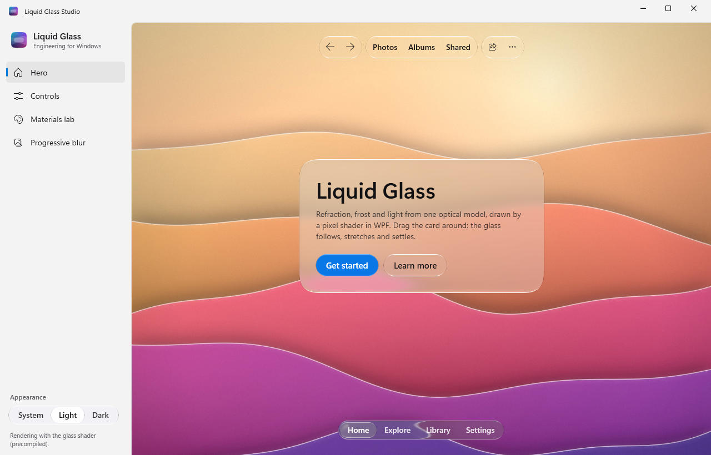

# Liquid Glass Engineering

Native Liquid Glass for iOS, macOS, Android and Windows: refraction, Clear and Regular materials, rim light and elastic interaction, with one optical model shared across SwiftUI, Jetpack Compose and WPF.

<p align="center">
  
  
  
</p>

<p align="center">
  <a href="https://github.com/rookasrudzianskas/liquid-glass-mac-windows-ios-android/actions/workflows/apple.yml"></a>
  <a href="https://github.com/rookasrudzianskas/liquid-glass-mac-windows-ios-android/actions/workflows/android.yml"></a>
  <a href="https://github.com/rookasrudzianskas/liquid-glass-mac-windows-ios-android/actions/workflows/windows.yml"></a>
  <a href="https://github.com/rookasrudzianskas/liquid-glass-mac-windows-ios-android/actions/workflows/website.yml"></a>
  <a href="https://github.com/rookasrudzianskas/liquid-glass-mac-windows-ios-android/actions/workflows/spec.yml"></a>
  <a href="LICENSE"></a>
  <a href="CHANGELOG.md"></a>
</p>

<p align="center">
  <a href="https://liquid-glass-engineering.vercel.app">Website</a> ·
  <a href="https://liquid-glass-engineering.vercel.app/docs">Docs</a> ·
  <a href="https://liquid-glass-engineering.vercel.app/downloads">Downloads</a> ·
  <a href="https://liquid-glass-engineering.vercel.app/playground">Playground</a> ·
  <a href="https://liquid-glass-engineering.vercel.app/skills">Skills</a> ·
  <a href="https://liquid-glass-engineering.vercel.app/llms.txt">llms.txt</a>
</p>

Each port draws the glass itself on the GPU, with Metal, AGSL or an HLSL pixel shader, from the same equations, constants and golden test vectors, so a design looks the same everywhere. None of them depends on the operating system's own glass, so the same look runs on iOS 17, Android 13 and Windows 10.

- [Platforms](#platforms)
- [Install](#install)
- [Quick start](#quick-start)
- [Components](#components)
- [Accessibility and fallbacks](#accessibility-and-fallbacks)
- [Limitations](#limitations)
- [Liquid Glass Studio](#liquid-glass-studio)
- [Examples](#examples)
- [Agent skills](#agent-skills)
- [Repository layout](#repository-layout)
- [Building from source](#building-from-source)
- [Specification and porting](#specification-and-porting)
- [Contributing](#contributing)
- [License](#license)

## Platforms

| | Apple | Android | Windows |
| --- | --- | --- | --- |
| UI framework | SwiftUI | Jetpack Compose | WPF |
| Glass renderer | Metal | AGSL `RenderEffect` | HLSL pixel shader 3.0 |
| Package | Swift package, product `LiquidGlass` | `io.github.rookasrudzianskas:liquid-glass-compose` | NuGet `LiquidGlassEngineering.Wpf` |
| Requirements | iOS 17+, macOS 14+; Xcode 16+ (iOS 18 / macOS 15 SDK) | minSdk 24 (Android 7); GPU glass on API 33 (Android 13)+ | Windows 10 1809+ or Windows 11; `net48`, `net8.0-windows`, `net10.0-windows` |
| GPU glass | Every supported device | Android 13 and later | Pixel shader 3.0 (every DirectX 10-class GPU, and WARP) |
| Guide | [docs/apple.md](docs/apple.md) | [docs/android.md](docs/android.md) | [docs/windows.md](docs/windows.md) |

## Install

### Swift Package Manager (iOS, macOS)

In Xcode: **File › Add Package Dependencies…** and enter

```
https://github.com/rookasrudzianskas/liquid-glass-mac-windows-ios-android
```

or in `Package.swift`:

```swift
dependencies: [
    .package(url: "https://github.com/rookasrudzianskas/liquid-glass-mac-windows-ios-android", from: "1.0.0"),
],
targets: [
    .target(name: "MyApp", dependencies: [
        .product(name: "LiquidGlass", package: "liquid-glass-mac-windows-ios-android"),
    ]),
]
```

The package contains Metal shaders, which Xcode compiles; build and test it with Xcode or `xcodebuild` rather than the bare `swift build`.

### Gradle (Android)

The library is served from the project's Maven repository:

```kotlin
// settings.gradle.kts
dependencyResolutionManagement {
    repositories {
        google()
        mavenCentral()
        maven("https://liquid-glass-engineering.vercel.app/maven")
    }
}
```

```kotlin
// app/build.gradle.kts
dependencies {
    implementation("io.github.rookasrudzianskas:liquid-glass-compose:1.0.0")
}
```

JitPack (`com.github.rookasrudzianskas:liquid-glass-mac-windows-ios-android:<tag>`) and a plain AAR from the downloads page work too; see [Install](docs/android.md#install) in the Android guide.

### NuGet (Windows)

The packages are published on the project's own NuGet feed, not on nuget.org. Add the feed once, then the package:

```
dotnet nuget add source https://liquid-glass-engineering.vercel.app/nuget/index.json -n liquid-glass
dotnet add package LiquidGlassEngineering.Wpf
```

or in the project file:

```xml
<PackageReference Include="LiquidGlassEngineering.Wpf" Version="1.0.0" />
```

To keep the feed with the code, add a `nuget.config` next to the solution; see [Install](docs/windows.md#install) in the Windows guide.

## Quick start

Every port has the same three parts: a **scene** (the region where glass may appear), its **content** (the backdrop the glass refracts) and **glass surfaces** anywhere else in the scene, at any depth. A surface's own children, labels and icons, draw sharp above the glass.

### SwiftUI

```swift
import LiquidGlass
import SwiftUI

struct ContentView: View {
    var body: some View {
        GlassScene {
            GlassContent {
                Image("wallpaper")
                    .resizable()
                    .scaledToFill()
            }
            .ignoresSafeArea()

            VStack(spacing: 24) {
                GlassSurface(material: .regular, radius: 32, interactive: true) {
                    VStack(alignment: .leading, spacing: 8) {
                        Text("Liquid Glass").font(.largeTitle.bold())
                        Text("Refraction, frost and light.")
                    }
                    .padding(28)
                }

                HStack {
                    GlassButton("Play", systemImage: "play.fill") { }
                    GlassButton(icon: "heart", label: "Like") { }
                }
            }
        }
    }
}
```

### Jetpack Compose

```kotlin
@Composable
fun NowPlaying() {
    GlassScene(Modifier.fillMaxSize()) {
        // 1. The backdrop: anything Compose can draw.
        GlassContent(Modifier.fillMaxSize()) {
            Image(
                painterResource(R.drawable.album_art),
                contentDescription = null,
                modifier = Modifier.fillMaxSize(),
                contentScale = ContentScale.Crop,
            )
        }
        // 2. Glass anywhere in the scene refracts it.
        GlassSurface(
            Modifier.align(Alignment.Center).padding(24.dp),
            shape = GlassShape(28.dp),
            material = GlassMaterial.Regular,
        ) {
            GlassText("Now Playing", Modifier.padding(24.dp))
        }
        GlassButton(
            text = "Play",
            icon = Icons.Default.PlayArrow,
            onClick = { /* … */ },
            tint = Color(0xFF0A84FF),
            modifier = Modifier.align(Alignment.BottomCenter).padding(32.dp),
        )
    }
}
```

### WPF

```xml
<Window x:Class="Demo.MainWindow"
        xmlns="http://schemas.microsoft.com/winfx/2006/xaml/presentation"
        xmlns:x="http://schemas.microsoft.com/winfx/2006/xaml"
        xmlns:lg="https://liquid-glass-engineering.vercel.app/wpf"
        Title="Glass" Width="900" Height="600" UseLayoutRounding="True">
  <lg:GlassScene>
    <lg:GlassScene.Content>
      <Image Source="Assets/wallpaper.jpg" Stretch="UniformToFill" />
    </lg:GlassScene.Content>

    <lg:GlassSurface Material="Regular" Radius="28" Width="380" Padding="28"
                     HorizontalAlignment="Center" VerticalAlignment="Center">
      <StackPanel>
        <TextBlock Text="Liquid Glass" FontSize="32" FontWeight="SemiBold" />
        <TextBlock Text="Refraction, frost and light." Opacity="0.75" Margin="0,6,0,18" />
        <lg:GlassButton Content="Get started" Size="Large" Tint="#0A84FF" HorizontalAlignment="Left" />
      </StackPanel>
    </lg:GlassSurface>
  </lg:GlassScene>
</Window>
```

## Components

The same concepts carry the same names on every platform ([`spec/COMPONENTS.md`](spec/COMPONENTS.md) is the full contract, with the shared options and sizes):

| Concept | SwiftUI | Jetpack Compose | WPF |
| --- | --- | --- | --- |
| Scene: the region glass may refract | `GlassScene { … }` | `GlassScene { … }` | `<lg:GlassScene>` |
| Backdrop layer the glass refracts | `GlassContent { … }` | `GlassContent { … }` | `<lg:GlassScene.Content>` |
| Glass container | `GlassSurface { … }` / `.liquidGlass()` | `GlassSurface { … }` / `Modifier.liquidGlass()` | `<lg:GlassSurface>` |
| Button | `GlassButton` | `GlassButton` | `<lg:GlassButton>` |
| Toolbar (clusters, spacers) | `GlassToolbar`, `GlassToolbarSpacer` | `GlassToolbar`, `GlassToolbarSpacer` | `<lg:GlassToolbar>`, `<lg:GlassToolbarSpacer>` |
| Tabs with a moving glass lens | `GlassTabBar`, `GlassTab` | `GlassTabBar`, `GlassTab` | `<lg:GlassTabBar>`, `<lg:GlassTabBarItem>` |
| Slider | `GlassSlider` | `GlassSlider` | `<lg:GlassSlider>` |
| Switch | `GlassSwitch` | `GlassSwitch` | `<lg:GlassSwitch>` |
| Menu that grows out of its trigger | `GlassMenu`, `GlassMenuItem`, `GlassMenuDivider` | `GlassMenu`, `GlassMenuItem`, `GlassMenuDivider` | `<lg:GlassMenu>`, `<lg:GlassMenuItem>`, `<Separator />` |
| Progressive edge blur | `GlassProgressiveBlur` | `GlassProgressiveBlur` | `<lg:GlassProgressiveBlur>` |
| Continuous-corner shape | `GlassShape` | `GlassShape` | `GlassGeometry.Create(...)` |

Every option, default and platform-specific addition is in the guides: [SwiftUI](docs/apple.md), [Jetpack Compose](docs/android.md) and [WPF](docs/windows.md).

## Accessibility and fallbacks

- **Reduce transparency** replaces the glass with an opaque fill (`#F2F2F7` light, `#1C1C1E` dark, at 94%) that keeps the rim light. It follows the system setting on Apple platforms and Windows (*Transparency effects*); Android has no such setting, so `GlassScene` takes it as an option.
- **Increase contrast** switches to the Regular material and adds a one-unit inner border. Windows contrast themes draw glass with system colors.
- **Reduced motion** removes grow, stretch and overshoot, and springs become crossfades. The system setting always applies.
- **Controls keep their platform roles**, labels, values and keyboard behavior for VoiceOver, TalkBack and UI Automation, with focus rings on desktop and Dynamic Type or font scaling on touch. Glass itself is decorative.
- **Glass never crashes and never draws nothing.** Where the GPU path is unavailable (Android 12 and earlier, Windows without pixel shader 3.0 or in software rendering), it draws a fallback material with the rim light: over the platform's blur where there is one (Regular glass on Android 12 and on Windows), otherwise a translucent fill.

## Limitations

Each guide lists its port's limits in full ([SwiftUI](docs/apple.md#limitations), [Jetpack Compose](docs/android.md#limitations), [WPF](docs/windows.md#limitations)). These are the ones people meet first:

- **Glass refracts the scene's content layer, not the views beside it.** Whatever should show through the glass goes into `GlassContent` (`GlassScene.Content` in WPF); other views in the scene, and the labels on the glass, are not refracted.
- **SwiftUI: views backed by UIKit or AppKit** (a native `ScrollView`, `List`, `TextField`, `Map`, `WebView` or any `UIViewRepresentable`) cannot be drawn into the glass layer, so glass over them shows nothing of them. Keep them in the foreground, and scroll a backdrop with `GlassScrollView`.
- **Jetpack Compose: 16 GPU surfaces per scene** (`GlassDefaults.MaxSurfacesPerScene`). Surfaces beyond the limit draw the fallback material (Regular surfaces over a platform blur, Clear ones a translucent fill); nest scenes to go further.
- **Rotation:** the SwiftUI and Compose ports follow an ancestor's translation and scale, not its rotation: inside a rotated view SwiftUI misaligns the refraction and Compose draws the axis-aligned bounds. WPF follows rotation and skew too.
- **WPF: menus stay inside their window**, floating in the scene so they can refract its backdrop.

## Liquid Glass Studio

Each platform ships the same demo app, with the same four pages, so screenshots line up across platforms: **Hero** (a draggable Regular card, a floating toolbar and a tab bar), **Controls** (every button size and tint, sliders, switches, tab bars and menus), **Materials lab** (live material, appearance, refraction, radius and tint on a draggable lens) and **Progressive blur** (a scrolling list under blurred edges).

<p align="center">
  
</p>

Prebuilt apps are on the [downloads page](https://liquid-glass-engineering.vercel.app/downloads), with SHA-256 checksums:

| Platform | Download | Notes |
| --- | --- | --- |
| macOS 14+ | `liquid-glass-studio-macos.zip` | Ad-hoc signed, not notarized: allow it once in System Settings › Privacy & Security › Open Anyway (Control-click › Open on macOS 14). |
| Android 7+ | `liquid-glass-studio-android.apk` | `adb install liquid-glass-studio-android.apk` |
| Windows 10 1809+ (x64) | `LiquidGlassStudio-win-x64.zip` | Needs the [.NET 10 Desktop Runtime](https://dotnet.microsoft.com/download/dotnet/10.0). |
| Windows 10 1809+ (x64) | `LiquidGlassStudio-win-x64-self-contained.zip` | No .NET install needed. |
| Windows 11 on ARM64 | `LiquidGlassStudio-win-arm64.zip` | Needs the .NET 10 Desktop Runtime. |

On iPhone and iPad, run it from Xcode: open `platforms/apple/Studio/LiquidGlassStudio.xcodeproj` and pick the *LiquidGlassStudio* scheme. The sources are in [`platforms/apple/Studio`](platforms/apple/Studio), [`platforms/android/studio`](platforms/android/studio) and [`platforms/windows/src/LiquidGlass.Studio`](platforms/windows/src/LiquidGlass.Studio).

## Examples

[`examples/`](examples) holds **Hello Glass**, the smallest complete app on each platform: a Regular glass card with a title and two buttons, a switch that turns it from Regular into Clear glass, a toolbar and a floating tab bar, all over the aurora wallpaper. The three versions build the same screen in about a hundred lines each:

| Example | Platform |
| --- | --- |
| [`examples/swiftui/HelloGlass`](examples/swiftui/HelloGlass) | SwiftUI, iOS 17+ and macOS 14+ |
| [`examples/compose/HelloGlass`](examples/compose/HelloGlass) | Jetpack Compose, Android 7+ |
| [`examples/wpf/HelloGlass`](examples/wpf/HelloGlass) | WPF, Windows 10 1809+ |

Each builds against the source in this repository, and its README shows how to switch to the published package. CI builds all three.

## Agent skills

The repository is also a plugin marketplace. Its `liquid-glass` plugin carries agent skills that design and build with these libraries:

| Skill | Use |
| --- | --- |
| `liquid-glass` | Where and how to use glass, and which platform skill to read. |
| `liquid-glass-swiftui` | The SwiftUI API, with recipes. |
| `liquid-glass-compose` | The Jetpack Compose API, with recipes. |
| `liquid-glass-wpf` | The WPF API, with recipes. |
| `liquid-glass-port` | Porting the optical model to a new renderer, checked against the golden vectors. |

Install them from the marketplace:

```
/plugin marketplace add rookasrudzianskas/liquid-glass-mac-windows-ios-android
/plugin install liquid-glass@liquid-glass-engineering
```

or download `liquid-glass-skills.zip` (all skills) or a single skill from the [skills page](https://liquid-glass-engineering.vercel.app/skills). The skills live in [`plugins/liquid-glass/skills`](plugins/liquid-glass/skills).

## Repository layout

```
Package.swift, Sources/LiquidGlass/   Swift package: SwiftUI views and Metal shaders
Tests/LiquidGlassTests/               its unit, GPU and render tests
platforms/apple/                      Liquid Glass Studio for iOS and macOS, CI scripts
platforms/android/                    Gradle project: liquidglass (the library) and studio (the demo)
platforms/windows/                    LiquidGlass.sln: Core, Wpf, Studio, tests and CI tools
examples/                             Hello Glass for SwiftUI, Jetpack Compose and WPF
spec/                                 optical model, component contract, reference, shader, golden vectors
assets/wallpapers/                    the generated wallpapers every Studio uses
docs/                                 developer guides, also published on the website
plugins/                              the plugin and its agent skills
website/                              the website (Vite and React)
scripts/                              downloads, skill reference sync and plugin checks
jitpack.yml                           JitPack build of the Android library
```

## Building from source

| Part | Toolchain | Build and test |
| --- | --- | --- |
| Apple | Xcode 16 or later | `xcodebuild test -scheme LiquidGlass -destination 'platform=macOS'` |
| Android | JDK 17 and the Android SDK (platform 35); set `ANDROID_HOME`, or `sdk.dir` in `platforms/android/local.properties` (the Gradle wrapper is included) | `cd platforms/android && ./gradlew :liquidglass:testDebugUnitTest` |
| Windows | .NET 10 SDK (builds on macOS and Linux; the WPF tests need Windows) | `cd platforms/windows && scripts/dotnet.sh test tests/LiquidGlass.Core.Tests` |
| Website | Node 22 (20.19 or later) | `cd website && npm ci && npm run build` |

When Xcode is installed but not the selected developer directory, prefix the Apple commands with `DEVELOPER_DIR=/Applications/Xcode.app/Contents/Developer`. The full commands, including GPU tests, the demo apps and packaging, are under *Building and testing* in each guide: [Apple](docs/apple.md#building-and-testing), [Android](docs/android.md#building-and-testing), [Windows](docs/windows.md#building-and-testing).

After changing anything in `spec/`, `LICENSE` or `NOTICE.md`, regenerate the golden vectors and the skills' copies, and check the plugin:

```sh
node spec/generate-vectors.mjs
node scripts/sync-skill-references.mjs
node scripts/check-plugin.mjs
```

CI runs the same checks with `git diff --exit-code spec/vectors.json` and `node scripts/sync-skill-references.mjs --check`.

## Specification and porting

[`spec/`](spec) is the ground truth every port follows:

- [`OPTICS.md`](spec/OPTICS.md): the optical model in prose, with every constant (shape, refraction, materials, rim light, interaction, progressive blur, accessibility).
- [`COMPONENTS.md`](spec/COMPONENTS.md): the component contract.
- [`reference.mjs`](spec/reference.mjs): the executable reference in plain JavaScript.
- [`shaders/liquid-glass.glsl`](spec/shaders/liquid-glass.glsl): the canonical shader library that the Metal, AGSL and HLSL shaders translate.
- [`vectors.json`](spec/vectors.json): golden test data generated from the reference by `node spec/generate-vectors.mjs`. Each port reproduces it in its unit tests, within `1e-4` on the CPU and `2e-3` for values read back from the GPU.

To bring Liquid Glass to another renderer (Flutter, Unity, Godot, a WebGL canvas), follow the `liquid-glass-port` skill.

## Contributing

Contributions are welcome. Start with [CONTRIBUTING.md](CONTRIBUTING.md); see [CHANGELOG.md](CHANGELOG.md) for what changed, [SECURITY.md](SECURITY.md) to report a vulnerability, and [CODE_OF_CONDUCT.md](CODE_OF_CONDUCT.md).

## License

[MIT](LICENSE), Copyright (c) 2026 Rokas Rudzianskas.

The optical model is ported from [Glass HQ liquid-glass](https://github.com/Glass-HQ/liquid-glass), used under the MIT License, Copyright (c) 2026 Glass HQ. [NOTICE.md](NOTICE.md) carries its copyright and permission notice.

Liquid Glass Engineering is an independent native port. It is not affiliated with or endorsed by Apple Inc. Apple, iOS, macOS, SwiftUI and Xcode are trademarks of Apple Inc. Android and Jetpack Compose are trademarks of Google LLC. Windows and WPF are trademarks of Microsoft Corporation.
