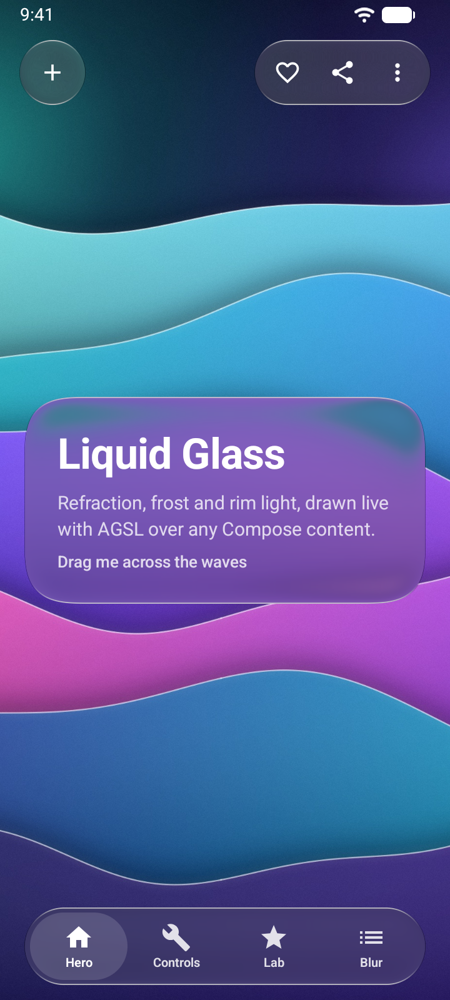
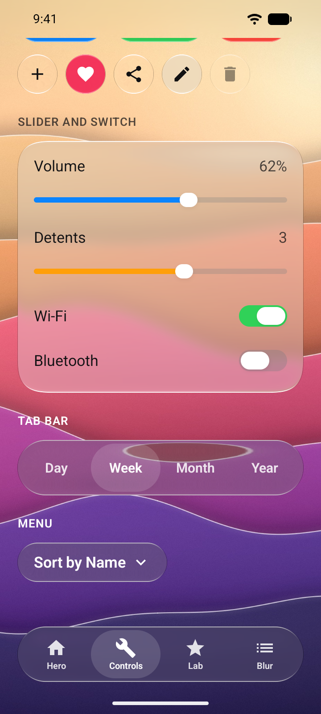
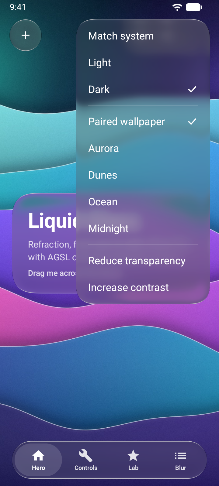
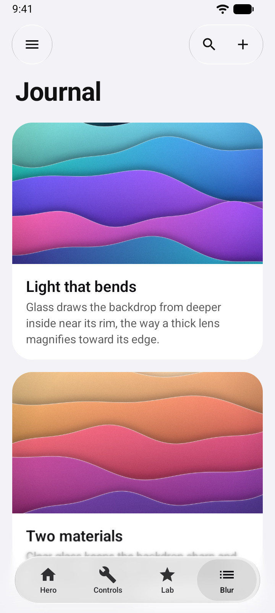
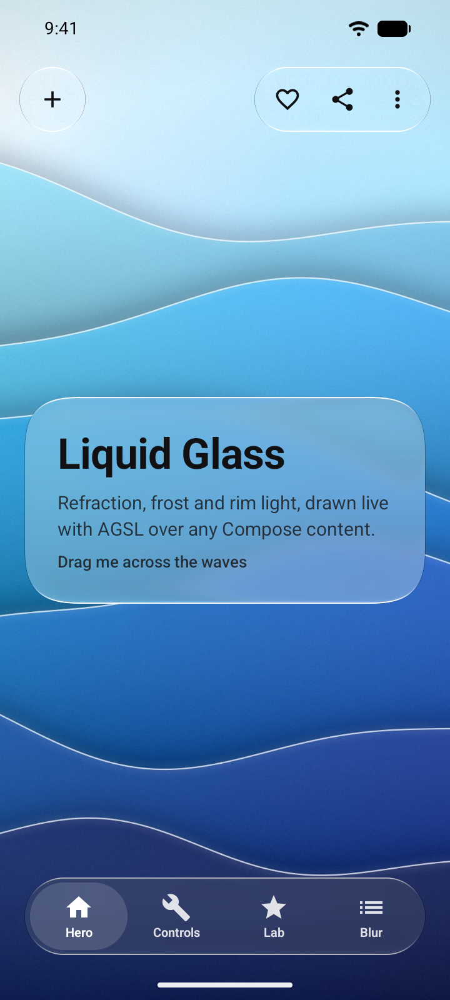
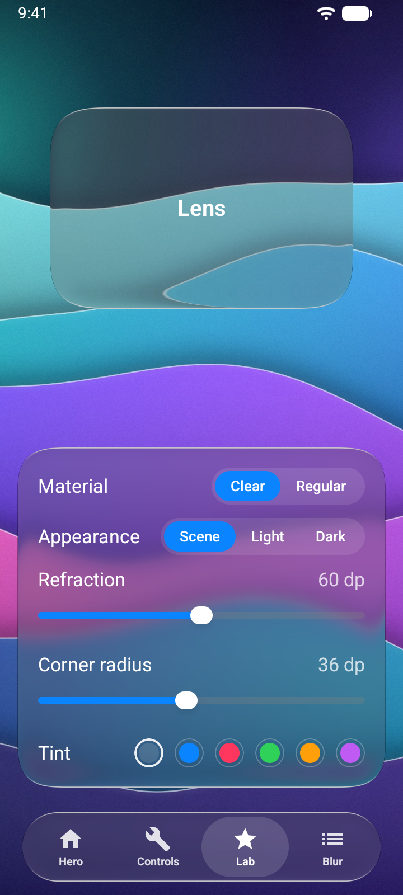

# Liquid Glass for Jetpack Compose

Native Liquid Glass for Android: refraction, Clear and Regular materials, rim light and elastic interaction, drawn on the GPU with AGSL and sharing one optical model ([`spec/OPTICS.md`](../spec/OPTICS.md)) with the SwiftUI and WPF ports. Any Compose UI can sit behind the glass, including `LazyColumn` and other scrolling content, animation, and video drawn into a `TextureView`; the glass follows it every frame.

<p align="center">
  
  
  
  
</p>

| | |
| --- | --- |
| Artifact | `io.github.rookasrudzianskas:liquid-glass-compose:1.0.1` |
| Min SDK | 24 (Android 7). The GPU glass path needs 33 (Android 13); below that a fallback material is drawn. |
| Built with | Kotlin 2.0.21, Compose UI/Foundation 1.7.6, compileSdk 35 |
| Dependencies | `androidx.compose.ui:ui`, `androidx.compose.foundation:foundation`, `androidx.activity:activity-compose` |
| License | MIT |

## Contents

1. [Install](#install)
2. [Quick start](#quick-start)
3. [How it works](#how-it-works)
4. [Components](#components)
5. [Theming and options](#theming-and-options)
6. [Interaction and motion](#interaction-and-motion)
7. [Accessibility](#accessibility)
8. [Performance](#performance)
9. [Fallbacks](#fallbacks)
10. [Limitations](#limitations)
11. [Liquid Glass Studio (demo app)](#liquid-glass-studio)
12. [Building and testing](#building-and-testing)
13. [FAQ](#faq)

## Install

### From the project's Maven repository

```kotlin
// settings.gradle.kts
dependencyResolutionManagement {
    repositories {
        google()
        mavenCentral()
        maven("https://liquid-glass-engineering.vercel.app/maven")
    }
}
```

```kotlin
// app/build.gradle.kts
dependencies {
    implementation("io.github.rookasrudzianskas:liquid-glass-compose:1.0.1")
    // Icons.Default.* in the quick start; apps on Material 3 usually have it already.
    implementation("androidx.compose.material:material-icons-core:1.7.6")
}
```

The repository carries the AAR, sources, javadoc and Gradle module metadata.

### From JitPack

JitPack is a secondary route; the project's Maven repository above stays the primary one. The first request for a version starts its build there, which can take a few minutes; if Gradle gives up while that build runs, run it again.

```kotlin
// settings.gradle.kts
dependencyResolutionManagement {
    repositories {
        google()
        mavenCentral()
        maven("https://jitpack.io")
    }
}

// app/build.gradle.kts
dependencies {
    implementation("com.github.rookasrudzianskas:liquid-glass-mac-windows-ios-android:1.0.1")
    // Icons.Default.* in the quick start; apps on Material 3 usually have it already.
    implementation("androidx.compose.material:material-icons-core:1.7.6")
}
```

JitPack builds `platforms/android` from the release tag (see [`jitpack.yml`](../jitpack.yml)); the version is the tag name. Google's Maven and Maven Central are still needed for the Compose dependencies.

### As an AAR

Download `liquid-glass-compose-1.0.1.aar` from the website's downloads, put it in `app/libs/` and add `implementation(files("libs/liquid-glass-compose-1.0.1.aar"))` together with the Compose UI, Foundation and Activity Compose dependencies listed above, and `material-icons-core` for the quick start's icons (an AAR carries no dependency information).

The library needs no ProGuard or R8 rules.

## Quick start

```kotlin
@Composable
fun NowPlaying() {
    GlassScene(Modifier.fillMaxSize()) {
        // 1. The backdrop: anything Compose can draw.
        GlassContent(Modifier.fillMaxSize()) {
            Image(
                painterResource(R.drawable.album_art),
                contentDescription = null,
                modifier = Modifier.fillMaxSize(),
                contentScale = ContentScale.Crop,
            )
        }
        // 2. Glass anywhere in the scene refracts it.
        GlassSurface(
            Modifier.align(Alignment.Center).padding(24.dp),
            shape = GlassShape(28.dp),
            material = GlassMaterial.Regular,
        ) {
            GlassText("Now Playing", Modifier.padding(24.dp))
        }
        GlassButton(
            text = "Play",
            icon = Icons.Default.PlayArrow,
            onClick = { /* … */ },
            tint = Color(0xFF0A84FF),
            modifier = Modifier.align(Alignment.BottomCenter).padding(32.dp),
        )
    }
}
```

Three rules cover almost everything:

1. **One `GlassScene`** wraps the screen (or the part of it that has glass).
2. **One `GlassContent`** inside it, first, holds what the glass refracts: its content, and anything its modifier draws (`GlassContent(Modifier.fillMaxSize().background(gradient)) {}` works too).
3. **Glass goes anywhere else in the scene**: `GlassSurface`, `Modifier.liquidGlass()` and every `Glass*` control, at any depth, moving, scrolling, scaling or animating.

[`examples/compose/HelloGlass`](../examples/compose/HelloGlass) is a complete one-screen app built this way: a Regular glass card with a tinted and a plain button and a Frosted switch, a toolbar and a tab bar over the Aurora wallpaper, in one Kotlin file. It depends on `io.github.rookasrudzianskas:liquid-glass-compose:1.0.1`, resolved from this repository's source; its README shows how to take the published package instead.

## How it works

`GlassContent` records its content into a GPU layer. Every glass surface in the scene registers with the scene and, each frame, reports where it is (its bounds in the content layer, after its own press scale and its ancestors' translation and scale), its shape, material, appearance, tint, refraction, opacity and pointer glow. On Android 13 and newer the content layer then gets a `RenderEffect` built from an AGSL translation of [`spec/shaders/liquid-glass.glsl`](../spec/shaders/liquid-glass.glsl):

```
sharp  = glass shader on the content       (Clear glass, Reduce Transparency fill)
frost  = glass shader on mix(blur σ7.33, max|min(blur σ7.33, blur σ23|21.8), 0.34|0.65)   (Regular glass)
result = sharp + frost
```

One shader pass draws every surface: per pixel it finds the surfaces that cover it, evaluates the continuous-corner signed distance field, samples the backdrop displaced by the refraction profile (bilinear, and filtered across the rim's compression), applies the material tone curves, tint, rim light and glow, and composites them in z-order. Each pass also lets the glass the other passes draw hide what lies beneath it, by that glass's own alpha (rim light and side shade included), so the passes add up to exactly the z-ordered composite, including Clear glass over Regular glass. The Regular frost is exact: Skia blurs and blends in the window's color space, sRGB on ordinary windows, matching the reference's sRGB filter math. The shader converts every sample to gamma-encoded, unpremultiplied sRGB before the tone math (`toLinearSrgb` and the sRGB curve) and back afterwards. The optics are defined on the sRGB gamut: on a wide-gamut window the glass itself shows sRGB colors, while every pixel no glass term reaches (including the ring just outside each outline) passes through unconverted.

A surface's children (labels, icons) draw in their normal place, above the glass, and are not refracted. Uniforms are captured when a `RenderEffect` is created, so the shader passes are rebuilt whenever the content layer redraws: when its content changes, a surface moves (also when an ancestor's layer moves it without a relayout, as `Modifier.scale` or `graphicsLayer(translationX = …)` do, which the scene checks before each frame is drawn), a scene option changes, or a spring advances. Nothing runs while the scene is still.

The output is checked on a real GPU in two ways. `ShaderVectorTest` runs the shader's own functions (shape field, edge profile, refraction offset, tone curves, tint, the legibility backing, rim light and the full pixel composite) on the device GPU for every case in `spec/vectors.json`, at the spec's GPU tolerance of 2e-3, like the Metal and HLSL ports; the worst difference measured on an Android 17 emulator is 8.6e-5. `GlassRenderingTest` renders Clear, Regular, dark and tinted glass through the library's own scene, over a uniform backdrop and over the vectors' linear gradient (so refraction moves the color), and compares every pixel along the rims, edges and middle with the Kotlin port of `spec/reference.mjs`, at 2/255 for the 8-bit readback; it also covers Clear glass nested in Regular glass, glass under an ancestor's changing scale and translation, scene options changing while glass is on screen, and the size-based default refraction (a small capsule travels 0.75 × its height, measured at rest while its glass is grown, and scene and surface values are used as given). It renders menus with a row held pressed: untinted Regular and Clear menus, and Regular and Clear menus tinted system blue, system yellow and the dark-appearance system yellow (`#FFD60A`), over white and over black in both appearances, on the GPU; Regular and Clear menus in the fallback material, untinted and tinted (`#FFD60A` in dark appearance over white, system blue in light appearance over black); and menus under Reduce Transparency, untinted and tinted `#FFD60A`, on the GPU and in the fallback material. The items must take the label color of `menuForeground`, and every pixel of glass beside the labels, on the plain rows and the pressed one, must keep at least 5.2:1 with it on an untinted menu (5.25:1 is the lowest measured, a Clear menu in dark appearance over white) and 5.0:1 on a tinted one (5.10:1 is the lowest measured, the dark-appearance yellow on Regular glass in dark appearance over white; 5.25:1 on Clear glass); the GPU glass must match the reference's glass, tinted and then backed, the Reduce Transparency glass on both paths must be the opaque fill mixed toward the backing and painted at 94%, and the pressed row must be that glass with the label color mixed in at 8%. `GlassDensityTest` repeats the reference cases at a phone density (2.625), so the frost σ, the one-pixel antialiasing and the bevel run in real pixels. The worst difference measured is 1.5/255.

### Nesting scenes

A `GlassScene` may sit inside another scene's `GlassContent`. The inner scene renders its glass into its own content, and the whole result becomes the outer scene's backdrop. Use this when glass must float above other glass, or above ordinary UI that is itself over glass, for example a tab bar over a screen of glass controls:

```kotlin
GlassScene {
    GlassContent(Modifier.fillMaxSize()) {
        GlassScene {                                  // the page and its glass
            GlassContent(Modifier.fillMaxSize()) { Wallpaper() }
            Column { GlassButton("Hello", onClick = {}) /* … */ }
        }
    }
    GlassTabBar(tabs, selected, { selected = it }, Modifier.align(Alignment.BottomCenter))
}
```

Menus always open in the outermost scene so they draw above everything.

## Components

Every concept in [`spec/COMPONENTS.md`](../spec/COMPONENTS.md) has the same name here as on the other platforms.

### `GlassSurface` and `Modifier.liquidGlass`

`Modifier.liquidGlass()` turns any element into glass; `GlassSurface` is a `Box` with it applied that also provides the right foreground color to its content.

```kotlin
GlassSurface(
    modifier = Modifier.size(300.dp, 180.dp),
    shape = GlassShape(32.dp),          // continuous corners; GlassShape.Capsule, GlassShape.Circle
    material = GlassMaterial.Regular,   // null inherits the scene's
    appearance = null,                  // GlassAppearance.Light / Dark / Automatic; null inherits
    tint = Color.Unspecified,           // colors the glass, never the content
    refraction = 48.dp,                 // optical travel at the rim, used as given; Dp.Unspecified follows the size
    interactive = true,                 // press grow, drag stretch, glow
    contentAlignment = Alignment.Center,
) {
    GlassText("Liquid Glass")
}

Box(
    Modifier
        .size(120.dp, 44.dp)            // size first, like a background
        .liquidGlass(GlassShape.Capsule, interactive = true, opacity = 0.8f),
)
```

`opacity` fades the glass itself. An ancestor's `alpha` fades only the children, because the scene draws the glass. Pass an `InteractionSource` to drive the press from a `clickable` (so scrolling cancels it, as with every `GlassButton`).

### `GlassShape`

A `Shape` with the Liquid Glass outline: continuous superellipse corners (`GlassShape(16.dp)`) that meet the edges with continuous curvature and blend into a capsule as the radius grows, so animating it never jumps. Use it for clips, borders and backgrounds that must line up with glass:

```kotlin
Modifier.clip(GlassShape(20.dp)).border(1.dp, Color.White, GlassShape(20.dp))
```

### `GlassButton`

Touch sizes from the spec: `GlassButtonSize.Small` (34 dp), `Regular` (44 dp), `Large` (52 dp). Heights grow with font scale.

```kotlin
GlassButton(onClick = {}) { GlassIcon(Icons.Default.Add, null); GlassText("Add") }   // any content
GlassButton("Continue", onClick = {}, size = GlassButtonSize.Large)                  // text
GlassButton("Play", onClick = {}, icon = Icons.Default.PlayArrow, tint = Color(0xFF0A84FF)) // tinted
GlassButton(Icons.Default.Share, contentDescription = "Share", onClick = {})        // icon-only circle
GlassButton("Delete", onClick = {}, enabled = false)                                 // dimmed to 45%, glass and label
```

A tint makes a prominent button: the glass takes the color, and the label turns white or `#111113`, whichever has the higher WCAG contrast with the tinted glass (white on blue, red or purple; dark on yellow, mint, green or orange), as on the other platforms.

### `GlassText` and `GlassIcon`

Text and icons in the glass foreground color (`#111113` on light glass, white on dark), with the 17 sp semibold label style. `LocalGlassContentColor` holds the current color if you draw your own content (for example Material 3 `Text(color = LocalGlassContentColor.current)`).

### `GlassToolbar` and `GlassToolbarSpacer`

A 52 dp capsule. Buttons inside become toolbar items on the toolbar's glass. A spacer splits the items into separate glass clusters; flexible spacers share the free width.

```kotlin
GlassToolbar(Modifier.statusBarsPadding().padding(16.dp).fillMaxWidth()) {
    GlassButton(Icons.Default.Menu, "Sections", onClick = {})
    GlassToolbarSpacer()                              // flexible gap
    GlassButton(Icons.Default.Search, "Search", onClick = {})
    GlassButton(Icons.Default.Add, "New", onClick = {})
}
```

With `interactive = true` (the default) the cluster under the finger grows and lights up.

### `GlassTabBar`

A 62 dp capsule of tabs with a glass lens on the selection. The lens slides to a new tab on the track spring, lifting into glass of the bar's own material (so a Regular bar stays frosted under the selection) and stretching with its speed. Drag it across the bar to choose a tab; arrow keys move the selection.

```kotlin
var tab by rememberSaveable { mutableIntStateOf(0) }
GlassTabBar(
    tabs = listOf(GlassTab("Home", Icons.Default.Home), GlassTab("Search", Icons.Default.Search)),
    selectedIndex = tab,
    onSelectedIndexChange = { tab = it },
    modifier = Modifier.navigationBarsPadding().padding(16.dp).fillMaxWidth(),
    material = GlassMaterial.Regular,
)
```

Tabs without icons work as a segmented control (`GlassTab("Week")`). The selected tab's icon and label take the glass foreground (`selectedContentColor` overrides it), the others the foreground at 85% (`unselectedContentColor`), which stays legible over mid-tone backdrops. Labels keep a 4 dp gap and ellipsize at large font sizes.

### `GlassSlider`

At rest the thumb is an opaque white capsule. Pressed, it lifts into Clear glass that magnifies the track beneath it (growing 2.5 × 2 dp per side, refraction 5 dp) and stretches with its speed. Only horizontal drags belong to the slider, so it works inside vertical scrolling. Touching the track jumps the thumb there.

```kotlin
var volume by rememberSaveable { mutableFloatStateOf(0.6f) }
GlassSlider(volume, { volume = it }, tint = Color(0xFF0A84FF), label = "Volume")
GlassSlider(level, { level = it }, valueRange = 0f..5f, steps = 4, label = "Level")   // detents, each one a haptic tick
```

`tint` colors the fill; it defaults to the platform accent (Material You on Android 12+). With `enabled = false` the whole slider (track, fill and thumb) is dimmed to 45%. `label` names the slider for TalkBack, which reads the value as a percentage of the range; when the value means something else, describe it: `Modifier.semantics { stateDescription = "${size.roundToInt()} dp" }`.

### `GlassSwitch`

54 × 24 dp track, 32 × 20 dp thumb on the measured switch spring (response 0.47 s, damping 0.7). Pressed, the thumb lifts into Clear glass (growing 9 × 5.5 dp per side, refraction 7.75 dp); drag it across, or tap. The control occupies 54 × 44 dp; the extra height is the touch target.

```kotlin
var wifi by rememberSaveable { mutableStateOf(true) }
Row(verticalAlignment = Alignment.CenterVertically) {
    GlassText("Wi-Fi", Modifier.weight(1f).clearAndSetSemantics {})   // the switch carries the label
    GlassSwitch(wifi, { wifi = it }, tint = Color(0xFF30D158), label = "Wi-Fi")
}
```

`label` names the switch for TalkBack ("Wi-Fi, switch, on"); hide a visible label next to it from accessibility so it is not read twice. A disabled switch is dimmed to 45%.

### `GlassMenu`

A Regular glass panel that grows out of its trigger on the morph spring, covering it, and collapses back into it. A menu opened from a `GlassToolbar` item grows out of, and covers, the item's whole cluster. Outside taps, Back and Escape dismiss it; choosing an item runs its action and dismisses it.

The panel carries the legibility backing of [OPTICS §3](../spec/OPTICS.md#legibility-backing-menus): after the material color and tint, its glass is mixed 60% toward a solid `#F5F5F7` (light) or `#1C1C1E` (dark). The backing fades in with the morph, from none at the trigger to the full amount open, and never goes past it while the spring overshoots, so the glass leaves the trigger as the trigger's own glass and returns to it. The panel still refracts and frosts what lies behind it, at 40% strength. Other surfaces have no backing, and the amount is not an option.

Items take the menu's label color. On an untinted panel that is the glass foreground (`#111113` light, white dark). On a tinted panel it is white or `#111113`, whichever contrasts more with the tint mixed toward the backing, so it follows the appearance as well as the tint: a light menu tinted system blue (`#007AFF`) gets `#111113` labels, though the tint alone would take white. A highlighted row (hovered, keyboard-focused or pressed) mixes that color into the glass at 8%.

Untinted menus, Regular or Clear, in either appearance, keep their labels at 5.2:1 or more over any backdrop, highlighted rows included: on Regular glass, white labels over white in dark appearance get 6.51:1 (6.35:1 on Clear; 1.8:1 without the backing), `#111113` over black in light 8.74:1 (7.74:1 on Clear; 2.1:1 without the backing), and the lowest, a highlighted row, 5.24:1. Menus tinted with the platform's system colors, in the variants of either appearance, keep at least 5.0:1, highlighted rows included (5.07:1 at worst: the dark-appearance system yellow, `#FFD60A`, over white; the light-appearance colors keep 5.26:1). Very light tints (pure yellow and white, 4.37:1 and 4.13:1 at worst) can fall below 4.5:1 over white in dark appearance: tint menus with a deeper color, or not at all. Destructive items keep a floor of their own: `destructive = true` draws the label, icon and check mark in a red on the side of the labels, `#560D0A` (system red darkened) where they are `#111113`, at least 5.0:1, and in dark appearance, where they are white, a light pink, `#FFEEED`, so they stay readable on any backdrop: at least 4.5:1, highlighted rows included (the label carries the meaning); system red itself would fall to about 1.3:1 there at worst, and over a white backdrop no saturated red reaches 4.5:1 on dark menu glass. Their highlight mixes the menu's label color, not red.

```kotlin
var open by remember { mutableStateOf(false) }
GlassMenu(
    expanded = open,
    onDismissRequest = { open = false },
    trigger = { GlassButton(Icons.Default.MoreVert, "More", onClick = { open = true }) },
) {
    GlassMenuItem("Name", onClick = { sort = Name }, checked = sort == Name)
    GlassMenuItem("Date", onClick = { sort = Date }, checked = sort == Date)
    GlassMenuDivider()
    GlassMenuItem("Delete", onClick = { delete() }, icon = Icons.Default.Delete, destructive = true)
}
```

`checked` is null for actions; `true` or `false` makes the item a choice, shown with a check mark and announced as checked or not (a checkbox). The panel is as wide as its widest item, at least 220 dp and at most the safe area's width; longer labels and large fonts wrap onto more lines, and a panel taller than the safe area scrolls. Outside a scene the menu opens in a popup with the fallback material; the fallback material mixes the same backing into its fill, so menus keep the same floors there and below Android 13 too.

### `GlassProgressiveBlur`

Blurs the scene's content progressively toward one edge, as content scrolls under a toolbar or tab bar: six blur levels with σᵢ = blur·(i/6)², mixed by depth exactly as in the spec. Glass over the band refracts the blurred content.

```kotlin
GlassScene {
    GlassContent(Modifier.fillMaxSize()) {
        LazyColumn(Modifier.fillMaxSize(), contentPadding = PaddingValues(top = 120.dp, bottom = 120.dp)) { /* … */ }
    }
    GlassProgressiveBlur(GlassEdge.Top, Modifier.align(Alignment.TopCenter), size = 120.dp, blur = 20.dp)
    GlassProgressiveBlur(GlassEdge.Bottom, Modifier.align(Alignment.BottomCenter), size = 120.dp)
    GlassToolbar(Modifier.align(Alignment.TopCenter).statusBarsPadding().padding(16.dp).fillMaxWidth()) { /* … */ }
}
```

The band spans the full length of its edge and `size` deep, unless the modifier sizes it. `GlassEdge.Start` and `End` follow the layout direction.

## Theming and options

`GlassScene` sets the defaults for every surface inside it; each component can override them.

| Option | Values | Default | Notes |
| --- | --- | --- | --- |
| `material` | `GlassMaterial.Clear`, `Regular` | `Clear` (menus `Regular`) | |
| `appearance` | `GlassAppearance.Automatic`, `Light`, `Dark` | `Automatic` | `Automatic` follows `isSystemInDarkTheme()`, inside a scene and outside any; the foreground color follows the appearance. |
| shape | `GlassShape(radius)`, `GlassShape.Capsule`, `GlassShape.Circle` | surface 16 dp; buttons, toolbars, tab bars capsule; menus 28 dp | |
| `refraction` | `Dp` ≥ 0 | `min(60 dp, 0.75 × shorter side)` | Unset (`Dp.Unspecified`) on both the scene and the surface, each surface follows its own resting size: a 34 dp button travels 25.5 dp, a 44 dp one 33 dp, the 52 dp toolbar 39 dp, the 62 dp tab bar 46.5 dp and its lens 40.5 dp, anything 80 dp or more on both sides 60 dp, so small controls never pull in backdrop from far outside their outline. It is measured on the layout size, so press growth, stretch and a menu's morph do not change it. A value on the scene or on the surface is used as given, including the slider and switch thumbs' 5 and 7.75 dp. `GlassDefaults.refraction(width, height)` computes it. |
| `tint` | `Color` | none | On sliders and switches it colors the fill and track. |
| `interactive` | `Boolean` | `true` for buttons, toolbars, tab bars | |
| `motion` | `GlassMotion.Full`, `Reduced`, `None` | `Full` | The system setting always applies, see below. |

Options may change at any time: glass already on screen follows a scene's new appearance, material, refraction, motion, reduce transparency or increase contrast in the same frame, as it does a change of the system's contrast or animation settings. Outside any `GlassScene`, glass and controls use these defaults with the system's dark theme, "Remove animations" and contrast settings.

Constants live in `GlassDefaults` (`Refraction`, the full 60 dp travel, and `refraction(width, height)`, the size-based default; `SurfaceRadius`, `MenuRadius`, `LightContentColor`, `DarkContentColor`, `LabelTextStyle`, `MaxSurfacesPerScene`, `ProgressiveBlurSize`, `ProgressiveBlurRadius`).

## Interaction and motion

Interactive glass uses the spec's damped springs, solved in closed form and advanced with `withFrameNanos` only while something moves:

| Spring | Duration | Bounce | Used for |
| --- | --- | --- | --- |
| press | 0.24 s | 0.20 | finger down |
| release | 0.50 s | 0.42 | finger up: a gel-like overshoot |
| glow | 0.42 s | 0 | light under the finger |
| morph | 0.42 s | 0.18 | menus growing out of their trigger |
| track | 0.18 s (+0.0005·size while dragging) | 0 | the tab bar lens, drag follow |

A press grows the surface by `min(16%, 8 dp / size)`. Dragging while pressed stretches it toward the finger on a rubber band, preserving volume, and a radial glow (alpha 0.30 light, 0.16 dark) blooms under the finger. Mouse hover lights it to 35%. Glass only observes pointer input; your `clickable`, `draggable` and `pointerInput` modifiers keep working. With `interactive = false` glass stays still: it neither grows, stretches nor lights up, also when an `interactionSource` is passed (clicks on the element still work), so `GlassButton("Static", onClick = {}, interactive = false)` is a static glass button (every overload takes `interactive`, `refraction` and `motion`).

**Reduced motion:** with the system "Remove animations" setting (animator duration scale 0) or `motion = GlassMotion.Reduced`, glass does not grow, stretch or overshoot, and springs become critically damped crossfades. `GlassMotion.None` removes transitions entirely.

## Accessibility

- **TalkBack:** buttons have the Button role; switches have the Switch role and toggle state; sliders expose their range and accept "set progress"; tab bars are selectable groups of tabs; menu items have the Button role, choice items (`checked` set) are checkboxes announced as checked or not checked, and the menu is a pane. Glass itself is decorative and adds no nodes.
- **Labels:** icon-only buttons take a `contentDescription`; give every `GlassSlider` and `GlassSwitch` a `label` (and hide a visible label beside it with `Modifier.clearAndSetSemantics {}`), and a slider whose value is not a percentage a `stateDescription`. A button that toggles something announces its state with `Modifier.semantics { stateDescription = … }`.
- **Font scaling:** labels use `sp`, and controls grow with them; menu panels widen up to the safe area and wrap long items.
- **Disabled controls:** buttons, sliders and switches with `enabled = false` are dimmed to 45%, glass included (menu items to 40%), as on the other platforms.
- **Increase contrast:** adds a 1 dp inner border (black 18% light, white 28% dark) and uses the Regular material. By default it follows Android 14's contrast level (medium or higher) and "High contrast text" (`GlassDefaults.systemIncreaseContrast()`); pass `increaseContrast` to `GlassScene` to override.
- **Reduce transparency:** `GlassScene(reduceTransparency = true)` replaces the material with an opaque fill (`#F2F2F7` / `#1C1C1E` at 94%) and keeps the rim light. Android has no system setting for it, so expose it in your app's settings.
- **Haptics:** buttons tick on press, switches use `TOGGLE_ON` / `TOGGLE_OFF` (Android 14+), and slider detents and tab changes play segment ticks.
- **Keyboard:** buttons, sliders, switches, tabs and menu items are focusable and show a 2 dp focus ring when focused (menu items are highlighted too); arrow keys move tab and slider selection; Enter and Space toggle switches; Escape closes menus.

## Performance

- One shader pass draws all surfaces of a scene. Pixels outside every surface cost a bounds check per surface; glass pixels cost a few bilinear samples plus the tone, tint and rim math. The program is compiled once per process and shared by every scene, including the private scenes of sliders and switches.
- Regular glass adds two GPU blurs of the content layer (σ 7.33 dp and 23 dp). Skia downsamples large blurs, so they are cheap; scenes without Regular glass skip them.
- A scene refracts up to **16 surfaces** (`GlassDefaults.MaxSurfacesPerScene`) on the GPU at once; surfaces outside the scene's bounds, clipped away or faded out (`opacity` 0, like a tab bar's resting lens) don't count. Any beyond that draw the fallback material (Regular surfaces over a platform blur, Clear ones a translucent fill), so nothing disappears. Nest scenes to go further.
- Nothing animates while idle, including while a finger rests on a control after its springs settle. Only the shader passes are rebuilt when the content layer redraws (content changes, a surface moving, or a spring advancing); the frost and fallback blurs and each band's blur levels are kept until the density or the band's geometry changes.
- Progressive blur draws six band-sized blur layers per band; keep bands as small as the design allows.

## Fallbacks

| Where | What draws |
| --- | --- |
| Android 13+ inside a scene | The AGSL glass. |
| Android 12 inside a scene | The fallback material (Regular surfaces over the platform blur of the content, Clear ones a translucent fill), plus the rim light. Progressive blur works. |
| Android 7–11 inside a scene | The fallback material (a translucent fill) plus the rim light. Progressive blur becomes a fade toward the edge. |
| Outside any `GlassScene` | The fallback material (no backdrop to blur), plus the rim light. |
| Inside the scene's own `GlassContent` | The fallback material: glass cannot refract the layer it is part of. Use a nested scene. |
| Wholly outside the `GlassContent`'s bounds | The fallback material (the content layer has nothing there to refract). Glass across the content's edge keeps the GPU glass. |
| More than 16 surfaces | Surfaces beyond the limit get the fallback material (Regular surfaces over a platform blur, Clear ones a translucent fill). |

Glass never crashes and never draws nothing. Fallback menus mix the legibility backing into their fill like the GPU glass, so their labels keep the same floors (5.2:1 untinted, 5.0:1 on the system colors).

## Limitations

- Glass is drawn by the scene directly above `GlassContent`. Ordinary UI that the scene draws between the content and a surface appears above that surface's glass. Nest scenes when glass must cover other UI (see [Nesting scenes](#nesting-scenes)).
- Surfaces follow translation and scale of any ancestor (layout, `offset`, `graphicsLayer` in both forms, `Modifier.scale`, scrolling); under a scale the glass is a scaled copy, corners, refraction and glow included. Rotation is not supported and draws the axis-aligned bounds.
- Content drawn into a `SurfaceView` (the default of Media3's `PlayerView`, CameraX's `PreviewView` in `PERFORMANCE` mode, and map views) is composited by the system outside the view hierarchy, so glass cannot refract it and it shows through unrefracted. Render video and camera previews into a `TextureView`: `PlayerView` with `app:surface_type="texture_view"`, `PreviewView` with `implementationMode = PreviewView.ImplementationMode.COMPATIBLE`.
- Fade glass with `opacity` (or `liquidGlass(opacity = …)`); an ancestor's `alpha` fades only the children.
- Glass in a different window (a `Dialog` or `Popup`) cannot refract the scene behind it and draws the fallback material; `GlassMenu` uses the scene overlay instead of a window for this reason.
- Overlapping surfaces composite in order (shallower first, then registration order), whatever their materials. A surface above another refracts the content, not the glass beneath it.

## Liquid Glass Studio

<p align="center">
  
  
</p>

The demo app (`platforms/android/studio`) has the same four pages as every platform's Studio:

1. **Hero:** a draggable Regular glass card over a wallpaper, a floating toolbar (with the appearance, wallpaper and accessibility menu) and the tab bar.
2. **Controls:** buttons in every size, tinted and icon-only, sliders, switches, a segmented tab bar and a menu, scrolling under the tab bar.
3. **Materials lab:** live material, appearance, refraction, corner radius and tint on a draggable lens.
4. **Progressive blur:** a scrolling journal with blurred top and bottom edges under a glass toolbar.

Install the prebuilt [`liquid-glass-studio-android.apk`](https://liquid-glass-engineering.vercel.app/downloads/liquid-glass-studio-android.apk) from the website (`adb install liquid-glass-studio-android.apk`), or build it (below). Intent extras open a given state, which keeps screenshots reproducible:

```sh
adb shell am start -n io.github.rookasrudzianskas.liquidglass.studio/.MainActivity \
  --es page lab --es appearance dark --es wallpaper midnight --es material regular \
  --ez reduceTransparency false --ez increaseContrast false
```

## Building and testing

The Gradle project lives in `platforms/android`. It needs JDK 17 and the Android SDK (platform 35); set `ANDROID_HOME`, or `sdk.dir` in `platforms/android/local.properties`:

```sh
cd platforms/android
./gradlew :liquidglass:testDebugUnitTest          # Kotlin optics vs spec/vectors.json, menu label colors and contrast floors
./gradlew :liquidglass:connectedDebugAndroidTest  # shader vs spec/vectors.json, rendered glass vs the reference and menu label contrast on the GPU (Android 13+); the fallback on older versions
./gradlew lint
./gradlew :liquidglass:publishReleasePublicationToArtifactsRepository :liquidglass:exportAar
./gradlew :studio:assembleRelease
```

Outputs go to `artifacts/android/`: `liquid-glass-compose-1.0.1.aar` and a Maven repository in `maven/`. The AAR's `classes.jar`, and so every app built with the library, carries `LICENSE` and `NOTICE.md` under `META-INF/liquid-glass-compose/`, and the build fails when the release AAR or the Studio's release APK lacks them. A release build of the Studio is signed with the key named in `platforms/android/local-signing.properties` (`storeFile`, `storePassword`, `keyAlias`, `keyPassword`; never committed), or with the debug key when that file is absent. CI ([`.github/workflows/android.yml`](../.github/workflows/android.yml)) runs the unit tests, lint, the library and APK builds, the Hello Glass example's build and lint, and the device tests on Android 14 (the GPU glass), Android 12 (the fallback over the platform blur) and Android 9 (the fallback without blur) emulators.

The Hello Glass example is a Gradle build of its own that includes this one, so it builds the library from source:

```sh
cd examples/compose/HelloGlass
./gradlew :app:assembleDebug
```

## FAQ

**Can I use Material 3 components with it?** Yes. Put Material content inside `GlassContent` as the backdrop, or inside glass surfaces as their content. Material's `Text` takes its color from Material's theme, so use `GlassText`, or pass `color = LocalGlassContentColor.current`.

**Why don't I see refraction on my emulator?** The GPU path needs an Android 13+ system image with GPU emulation (`-gpu host` or `swiftshader_indirect`). Older images draw the fallback.

**Does it work with `LazyColumn` behind the glass?** Yes, scrolling content is the backdrop like anything else. The Studio's progressive blur page is a `LazyColumn` under a glass toolbar and tab bar.

**Can glass sit inside a scrolling list?** Yes. Glass surfaces in a scrolling `Column` or `LazyColumn` outside the `GlassContent` move with it, and clipping by the list is honored: glass the list cuts off stays cut at the list's edge, also while it grows under a press. Compose does not expose an ancestor's clip, so a surface that is fully visible but within a few dp of the list's edge may grow past that edge while pressed.

**How do I make glass react to the backdrop's brightness?** Choose the appearance per surface: `appearance = GlassAppearance.Dark` over dark content. The Studio does this for its tab bar.

**Is it the same glass as on iOS, macOS and Windows?** Yes: the same functions, constants and golden vectors drive every port. The Kotlin math is unit-tested against `spec/vectors.json` to 1e-4, the AGSL shader against the same vectors on the GPU to 2e-3, and the rendered glass against the Kotlin math.
