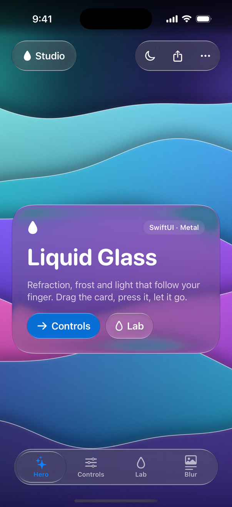
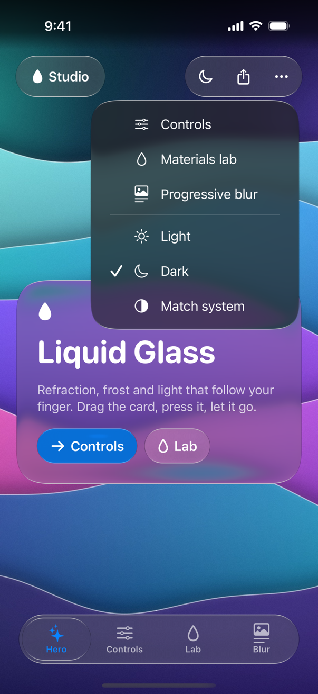
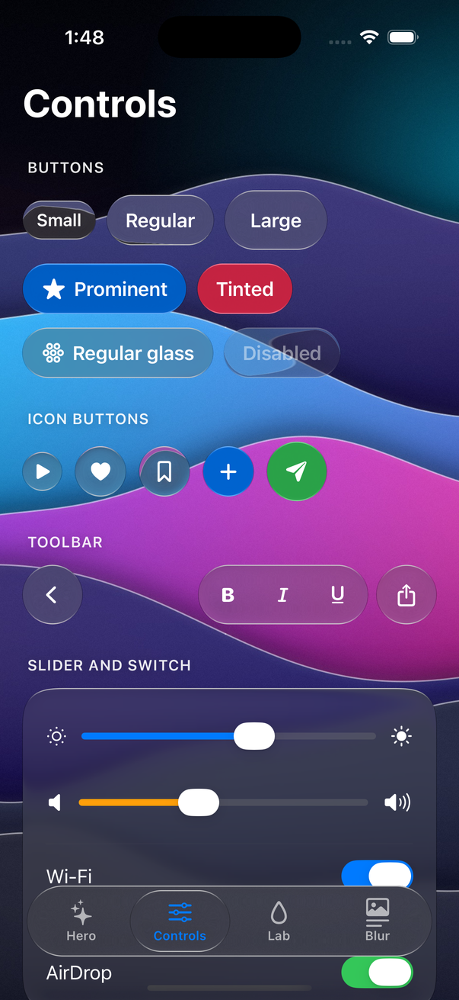
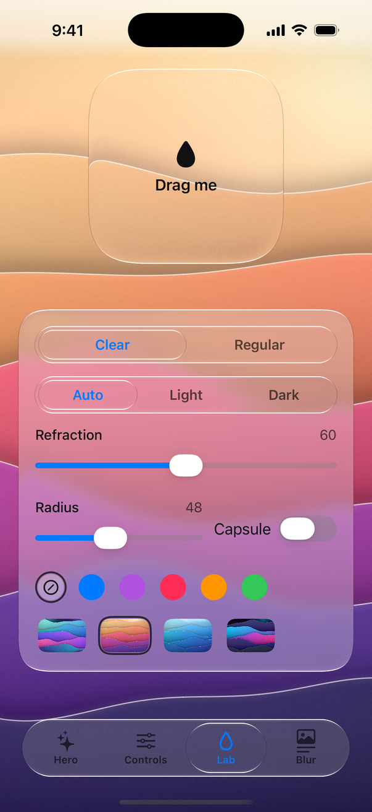
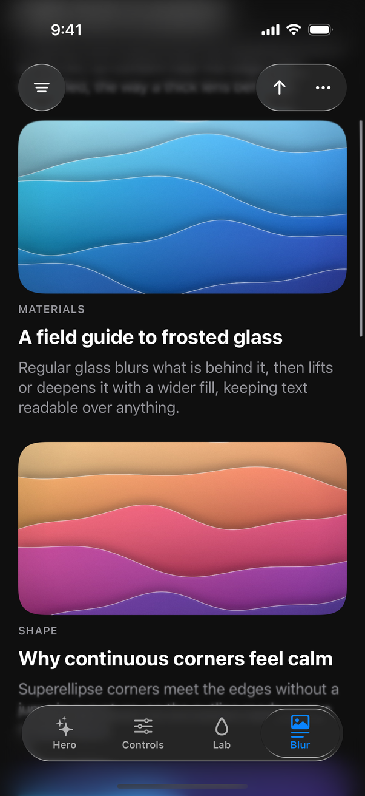
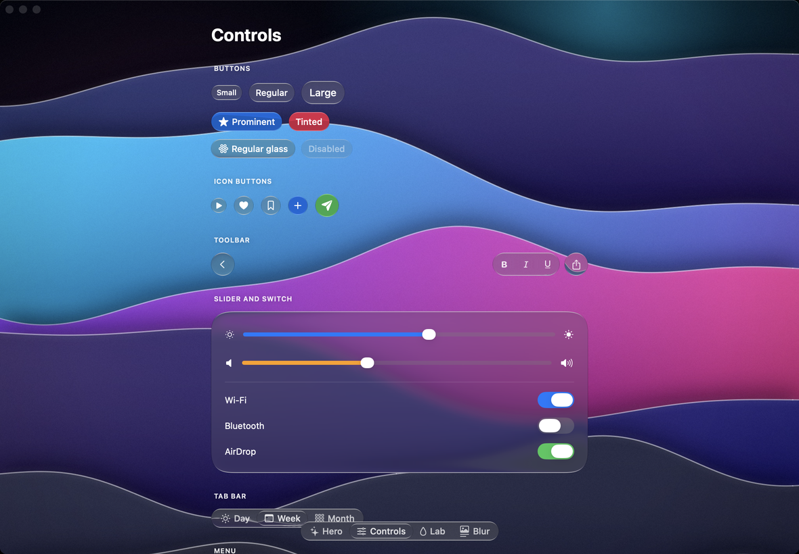

# Liquid Glass for SwiftUI (iOS and macOS)

`LiquidGlass` is a native Liquid Glass library for SwiftUI on **iOS 17+** and **macOS 14+**, rendered with Metal. It implements the shared optical model of [`spec/OPTICS.md`](../spec/OPTICS.md): continuous-corner shapes, bevel refraction, the Clear and Regular materials, tint, rim light, coverage antialiasing, the pointer glow, the elastic press-and-drag response and progressive blur. The same equations, constants and golden test vectors drive the Android, Windows and web ports, so a design looks the same everywhere.

It does not depend on iOS 26's `glassEffect`. No type is called plain `Glass`, so the library coexists with SwiftUI's own glass on newer systems.



- [Install](#install)
- [Quick start](#quick-start)
- [Concepts](#concepts)
- [Components](#components)
- [Options and theming](#options-and-theming)
- [Accessibility](#accessibility)
- [Performance](#performance)
- [How it works](#how-it-works)
- [Limitations](#limitations)
- [Liquid Glass Studio](#liquid-glass-studio)
- [Building and testing](#building-and-testing)
- [FAQ](#faq)

## Install

Swift Package Manager, in Xcode: **File › Add Package Dependencies…** and enter

```
https://github.com/rookasrudzianskas/liquid-glass-mac-windows-ios-android
```

or in `Package.swift`:

```swift
dependencies: [
    .package(url: "https://github.com/rookasrudzianskas/liquid-glass-mac-windows-ios-android", from: "1.0.0"),
],
targets: [
    .target(name: "MyApp", dependencies: [
        .product(name: "LiquidGlass", package: "liquid-glass-mac-windows-ios-android"),
    ]),
]
```

Requirements: iOS 17 or macOS 14 deployment targets, built with Xcode 16 or later (iOS 18 / macOS 15 SDK; Xcode 15 cannot compile the iOS target). There are no third-party dependencies.

> The package contains Metal shaders. Xcode compiles them (in an app, with `xcodebuild`, or in Xcode's own package build). The bare command line `swift build` does not compile Metal, so build and test the package with Xcode or `xcodebuild`.

## Quick start

```swift
import LiquidGlass
import SwiftUI

struct ContentView: View {
    var body: some View {
        GlassScene {
            GlassContent {
                Image("wallpaper")
                    .resizable()
                    .scaledToFill()
            }
            .ignoresSafeArea()

            VStack(spacing: 24) {
                GlassSurface(material: .regular, radius: 32, interactive: true) {
                    VStack(alignment: .leading, spacing: 8) {
                        Text("Liquid Glass").font(.largeTitle.bold())
                        Text("Refraction, frost and light.")
                    }
                    .padding(28)
                }

                HStack {
                    GlassButton("Play", systemImage: "play.fill") { }
                    GlassButton(icon: "heart", label: "Like") { }
                }
            }
        }
    }
}
```

Everything glass lives inside a `GlassScene`. The scene's first element, `GlassContent`, is the backdrop glass refracts; everything after it is the foreground, where glass can sit at any depth: in stacks, in a native `ScrollView`, in your own views.

## Concepts

| Concept | API |
| --- | --- |
| Scene: the region glass may refract | `GlassScene { … }` |
| Backdrop layer the glass refracts | `GlassContent { … }` |
| Glass container | `GlassSurface { … }` and `.liquidGlass(…)` |
| Button | `GlassButton` |
| Toolbar with clusters and spacers | `GlassToolbar`, `GlassToolbarSpacer` |
| Tabs with a moving glass lens | `GlassTabBar`, `GlassTab` |
| Slider | `GlassSlider` |
| Switch | `GlassSwitch`, `GlassSwitchStyle` |
| Menu that grows out of its trigger | `GlassMenu`, `GlassMenuItem`, `GlassMenuDivider` |
| Progressive edge blur | `GlassProgressiveBlur` |
| Continuous-corner shape | `GlassShape` (an `InsettableShape`) |
| Scrolling backdrop | `GlassScrollView`, `GlassScrollPosition` |
| Optical model on the CPU | `GlassOptics`, `GlassSpring` |

### GlassScene and GlassContent

```swift
GlassScene(material: .regular, appearance: .dark) {
    GlassContent { MapSnapshot() }
        .ignoresSafeArea()          // backdrop under the status bar and home indicator
    MyForeground()                  // respects the safe area as usual
}
```

- A scene fills the space it is offered, like `GeometryReader`, and lays its foreground over the backdrop like a `ZStack`.
- `GlassContent` must be the **first** element. The scene builder takes a fixed list of views; put `if` or `ForEach` inside a container (`ZStack`, `Group`, `VStack`).
- `GlassContent { … }.ignoresSafeArea(_:)` extends the backdrop under the safe area while the foreground keeps respecting it.
- Scene parameters (`material`, `appearance`, `refraction`, `motion`) become the defaults of every glass element inside. `nil` inherits from the environment.

### What can go in GlassContent

The backdrop renders once on screen and once more, clipped, inside every glass surface (see [How it works](#how-it-works)). So:

- Keep it **a pure function of external state**: pass bindings or `@Observable` models into it. `@State` stored *inside* the content is separate in each copy.
- Use **pure SwiftUI views**: images, shapes, gradients, text, `Canvas`, custom layouts, color and layer effects. Views backed by UIKit or AppKit (native `ScrollView`, `List`, `Form`, `TextField`, `TextEditor`, `Map`, `VideoPlayer`, `WebView`, any `UIViewRepresentable`/`NSViewRepresentable`) cannot be drawn into a shader effect: SwiftUI drops them from the glass layer, so glass over them shows nothing. Place such views in the foreground instead, or use `GlassScrollView` to scroll a backdrop.
- Its layout does not see safe-area insets; give it explicit padding where it needs room for bars.
- Glass surfaces placed *inside* `GlassContent` render without glass in the copies (glass never refracts glass).

## Components

### GlassSurface

```swift
GlassSurface(material: .regular, radius: 28, tint: .blue, interactive: true) {
    Label("Now Playing", systemImage: "music.note").padding()
}

// The same, as a modifier:
Label("Now Playing", systemImage: "music.note")
    .padding()
    .liquidGlass(.regular, radius: 28, tint: .blue, interactive: true)
```

| Parameter | Default | |
| --- | --- | --- |
| `material` | scene's (`.clear`) | `.clear` or `.regular` |
| `appearance` | scene's (`.automatic`) | `.automatic`, `.light`, `.dark` |
| `radius` | `16` | points, `.capsule` or `.circle` |
| `refraction` | scene's (`60`) | optical travel at the rim, points |
| `tint` | none | colors the glass, never the content |
| `interactive` | `false` | press grow, drag stretch, glow |
| `motion` | scene's (`.full`) | `.full`, `.reduced`, `.none` |

Content draws above the glass, clipped to the outline, in the glass's foreground color (`#111113` on light glass, white on dark). Interactive surfaces grow under a press, stretch toward a drag with constant volume, settle with a gel-like overshoot and light up under the finger (and under the pointer on macOS and iPad). Surfaces you move yourself (with `.offset`, a `DragGesture`, layout changes or SwiftUI animations) keep refracting exactly what is under them.

### GlassButton

```swift
GlassButton("Play", systemImage: "play.fill") { play() }
GlassButton(icon: "plus", label: "Add") { add() }                 // icon-only circle
GlassButton("Buy", prominent: true) { buy() }                     // accent-tinted glass, white label
GlassButton("Delete", tint: .red) { delete() }
GlassButton("Frosted", material: .regular) { }
GlassButton(radius: 12, action: { }) { Text("Custom label") }     // any label, any outline
```

Sizes follow `controlSize`:

```swift
GlassButton("Small") { }.controlSize(.small)     // 34 pt (iOS), 22 pt (macOS)
GlassButton("Regular") { }                        // 44 pt, 28 pt
GlassButton("Large") { }.controlSize(.large)     // 52 pt, 34 pt
```

Heights scale with Dynamic Type. Labels are 17 pt semibold on iOS and 13 pt medium on macOS. Icon-only buttons are circles whose title becomes the VoiceOver label and the macOS tooltip. A `GlassButton` is a SwiftUI `Button`, so `.disabled`, `.keyboardShortcut`, roles and focus work as usual.

### GlassToolbar and GlassToolbarSpacer

```swift
GlassToolbar {
    GlassButton(icon: "chevron.left", label: "Back") { }
    GlassToolbarSpacer()                    // splits the row into clusters
    GlassButton(icon: "bold", label: "Bold") { }
    GlassButton(icon: "italic", label: "Italic") { }
    GlassToolbarSpacer(.fixed)              // a fixed 8 pt gap
    GlassMenu(icon: "ellipsis", label: "More") { … }
}
```

Each cluster sits on its own capsule (52 pt tall with a 4 pt inset on iOS, 34 and 3 on macOS). Buttons and menus inside a toolbar drop their own glass and highlight with the foreground color at 8% when pressed, hovered or focused; pressing anywhere on a cluster grows it and lights it under the finger. `GlassToolbar(material:appearance:tint:interactive:motion:)`.

### GlassTabBar

```swift
enum Page: Hashable { case home, search, library }
@State private var page = Page.home

GlassTabBar(selection: $page) {
    GlassTab("Home", systemImage: "house", value: Page.home)
    GlassTab("Search", systemImage: "magnifyingglass", value: Page.search)
    GlassTab("Library", systemImage: "books.vertical", value: Page.library)
}
```

A clear glass lens slides to the selected tab on the track spring and stretches with its speed; drag across the bar to carry the lens and release to choose the tab under it. On iOS the bar is 62 pt tall with icon and label, the selected item takes the accent color and labels stop growing at the largest text sizes (the Large Content Viewer shows them). `.controlSize(.small)` makes a compact, segmented-style bar (40 pt on iOS, 24 pt on macOS). On macOS the bar is 28 pt tall with labels, unselected labels at 85% and the arrow keys move the selection. Haptic selection feedback plays on change.

### GlassSlider

```swift
@State private var volume = 40.0

GlassSlider(value: $volume, in: 0...100) { Text("Volume") }
GlassSlider(value: $volume, in: 0...100, step: 10, tint: .orange) { Text("Volume") }
```

The thumb is an opaque white capsule at rest and lifts into clear glass while held (20 × 16 pt growing 2.5 × 2 pt per side with refraction 5 on macOS; 36 × 24 pt on iOS for touch). The lifted lens refracts the track and fill beneath it and stretches along the track with its speed. Press anywhere on the track to jump there and keep dragging. Stepped sliders play a selection haptic per step. VoiceOver sees a standard adjustable slider (`accessibilityRepresentation`), and on macOS the arrow keys adjust it when focused. `onEditingChanged` reports drags.

### GlassSwitch

```swift
@State private var wifi = true

GlassSwitch("Wi-Fi", isOn: $wifi)
GlassSwitch("AirDrop", isOn: $airdrop, tint: .green)
Toggle("Bluetooth", isOn: $bluetooth).toggleStyle(GlassSwitchStyle())
```

Tap to toggle or drag the thumb across. The thumb travels on the measured switch spring (response 0.47 s, damping 0.7) and lifts into clear glass while held (32 × 20 pt in a 54 × 24 pt track, growing 9 × 5.5 pt per side with refraction 7.75 on macOS; 37 × 24 in 63 × 28 on iOS). The track takes `tint` (the accent color by default) when on. It's a `Toggle`, so VoiceOver, `labelsHidden()` and focus work as usual; Space toggles it on macOS.

### GlassMenu

```swift
GlassMenu("Sort", systemImage: "arrow.up.arrow.down") {
    GlassMenuItem("Newest", systemImage: "clock") { sort = .newest }
    GlassMenuItem("Oldest", systemImage: "clock.arrow.circlepath") { sort = .oldest }
    GlassMenuDivider()
    GlassMenuItem("Reset", systemImage: "trash", role: .destructive) { reset() }
}

GlassMenu(icon: "ellipsis", label: "More") { … }   // icon-only trigger
```



The trigger is a `GlassButton`. Opening morphs the trigger's glass into a Regular glass panel (radius 28) on the morph spring while the items condense out of a blur; closing reverses it. The panel opens below the trigger with trailing edges aligned, flips above when there is no room and stays inside the scene. Items highlight with the foreground color at 8%. Tap outside, press Escape, or choose an item to dismiss; the up and down arrows and Return navigate. The panel draws in the scene's overlay, above the rest of the foreground. Outside a `GlassScene`, `GlassMenu` falls back to the system `Menu` with the same items.

### GlassProgressiveBlur

```swift
GlassScene {
    GlassContent { GlassScrollView(position: scroll) { Articles() } }
        .ignoresSafeArea()

    VStack {
        GlassProgressiveBlur(edge: .top, size: 120)
            .ignoresSafeArea(edges: .top)
        Spacer()
        GlassProgressiveBlur(edge: .bottom)
            .ignoresSafeArea(edges: .bottom)
    }
}
```

Six blur levels over the sharp backdrop, level *i* at σ = `blur`·(*i*/6)², weighted by the smoothstep of the depth so the weights sum to 1 (OPTICS §7). Defaults: `size` 80, `blur` 20. It fills the width (or height) it is offered, never takes touches, and blurs the backdrop only (glass above it still refracts the sharp backdrop, so bars over scrolling text usually want `material: .regular`).

### GlassScrollView

```swift
@State private var scroll = GlassScrollPosition()

GlassContent {
    GlassScrollView(position: scroll) {
        VStack { ForEach(stories) { StoryCard($0) } }
            .padding(.top, 120)        // room for the toolbar; backdrops don't see the safe area
    }
}

GlassButton(icon: "arrow.up", label: "Top") { scroll.scrollTo(edge: .top) }
```

A scroll view drawn entirely by SwiftUI, so glass can refract it. On iOS it scrolls with a drag, decelerates like `UIScrollView` (× 0.998 per millisecond) and rubber-bands past the ends with `GlassOptics.rubberBand`, settling back on a critically damped spring. On macOS it follows the trackpad (with the system's momentum) and the mouse wheel. `GlassScrollPosition` is `@Observable`: read `offset`, `contentSize`, `viewportSize` and `isScrolling`, or call `scrollTo(_:animated:)` and `scrollTo(edge:animated:)`. The position must live outside the content (in `@State` next to the scene) because every copy of the backdrop reads it. VoiceOver's three-finger scroll works. Content is laid out at its ideal length along the scrolling axes, so `LazyVStack` renders every row.

### GlassShape

```swift
Image("cover")
    .clipShape(GlassShape(radius: 24))

GlassShape(radius: .capsule).strokeBorder(.white.opacity(0.3), lineWidth: 1)
```

The same continuous-corner outline the shader draws: superellipse corners (exponent 3.26) whose diagonal inset matches a circular corner of radius *r*, blending into a capsule for large radii. `GlassShape` is an `InsettableShape`.

### GlassOptics and GlassSpring

The optical model is public, for custom renderers, layout and tests:

```swift
let params = GlassOptics.shapeParameters(width: 200, height: 64, radius: .capsule)
let field = GlassOptics.shapeField(x: 90, y: 0, width: 200, height: 64, extent: params.extent, exponent: params.exponent)
let offset = GlassOptics.refractionOffset(distance: field.distance, nx: field.nx, ny: field.ny)

var state = GlassSpring.State(value: 0, target: 1)
state = GlassSpring.release.step(state, dt: 1 / 60)     // closed form, frame-rate independent
```

## Options and theming

Every option inherits through the environment, from the scene or any ancestor:

```swift
VStack { … }
    .glassMaterial(.regular)
    .glassAppearance(.dark)
    .glassRefraction(40)
    .glassMotion(.reduced)
```

- **Material.** `.clear` refracts sharply with a light tone curve. `.regular` frosts the backdrop (a σ 7.33 blur brightened, or deepened in dark appearance, by a wide fill blur) and keeps text legible over anything. Menus default to `.regular`.
- **Appearance.** `.automatic` follows the color scheme. `.light` and `.dark` force the tone curves and rim strength, and set the content's color scheme, so `.primary` and `.secondary` adapt.
- **Radius.** Numbers are continuous-corner radii; `.capsule` and `.circle` round fully.
- **Refraction.** Points of optical travel at the rim; 0 turns refraction off. Small controls (shorter than the 20 pt bevel) refract across their whole face.
- **Tint.** Colored glass transmits the backdrop's luminance through the pigment. Tinted buttons draw white labels. On sliders and switches, `tint` colors the fill and track.
- **Motion.** `.full`, `.reduced` (no grow, stretch or overshoot; the light still fades) and `.none` (no transitions). The system Reduce Motion setting always applies on top.
- **Foreground.** Text and icons on glass default to `#111113` (light) and white (dark); set your own `foregroundStyle` inside a surface to override.

## Accessibility

- **Reduce Transparency** replaces the material with an opaque fill (`#F2F2F7` at 94% light, `#1C1C1E` at 94% dark) and keeps the rim light.
- **Increase Contrast** switches to the Regular material and adds a one-point inner border (black 18% light, white 28% dark).
- **Reduce Motion** removes grow, stretch and overshoot; springs become critically damped crossfades.
- **Dynamic Type** scales button, toolbar and tab bar heights and labels; bars stop growing at the largest sizes and show the Large Content Viewer.
- **VoiceOver.** Buttons, tabs, switches, sliders and menu items keep their roles, labels, values, selected states and actions. Icon-only buttons use their title as the label. Menus are modal and close with the escape gesture. Glass layers are hidden from accessibility.
- **Keyboard (macOS).** Buttons and switches take focus (with Full Keyboard Access); tab bars and sliders respond to the arrow keys; menus to the arrow keys, Return and Escape; switches to Space. Focused buttons draw a ring in the glass outline's shape.
- **Haptics (iOS).** Tab selection and stepped sliders play selection feedback; switches play a light impact.

## Performance

- Each glass surface renders one clipped copy of the backdrop plus one fragment-shader pass over its own padded bounds. Cost scales with the glass area, not the screen.
- The Regular material adds one SwiftUI GPU blur of that copy and a 28-tap fill kernel in the shader.
- Springs run on a display link only while something moves; idle glass costs nothing per frame. Spring values are observed with Observation, so only the glass layers and transformed content redraw during an animation, never the backdrop or your views.
- `GlassScrollView` moves its content with an offset; scrolling redraws the offset, not the rows.
- Prefer a few large surfaces to many tiny overlapping ones, keep heavy backdrops (hundreds of views) lean because each copy instantiates them, and use `GlassProgressiveBlur` sparingly (it renders six blurred copies of its strip).

## How it works

### One copy of the backdrop per surface

SwiftUI's `layerEffect` (iOS 17, macOS 14) runs a Metal shader over a view's own pixels; it cannot read what lies beneath a view. Two designs can refract a backdrop:

1. **One shader pass over the scene's content**, with every surface's geometry as uniforms.
2. **One copy of the content per surface**, aligned to the visible content, with the shader applied to the copy.

LiquidGlass uses **per-surface copies**, after building and measuring both:

| | One pass over the content | Copy per surface (chosen) |
| --- | --- | --- |
| Geometry during SwiftUI animations | Preferences report the final layout, so glass lags or jumps while views animate | `visualEffect` reads render-time geometry: exact during drags, offsets, layout animations and transitions |
| Overlap and z-order | All glass is drawn beneath all surface content; a menu over a toolbar shows the toolbar's icons through the menu | Glass follows the view tree: a menu covers what is under it |
| State duplication | None | Content renders again in each copy; `@State` inside the content is per copy (pass state in from outside) |
| Animation sync | — | Copies share the transaction, so SwiftUI animations stay in sync |
| Cost | One full-screen pass | One pass per surface, clipped to its padded bounds |

Each copy measures its own on-screen frame at render time with `visualEffect` and moves (and under an ancestor's scale, rescales) the backdrop back into place, so the glass refracts what is exactly beneath it while it moves. The press growth and drag stretch are evaluated in the shader instead of as transforms, so the rim stays one device pixel wide while the glass grows. The glass layer outputs only the glass (`rim + glass·(1 − rim.a)` without the base term) and SwiftUI composites it over the visible backdrop, which is the spec's composite exactly.

### Touches

Interactive glass follows the finger without owning the touch. On iOS 18 and later a UIKit long-press recognizer with no minimum duration runs simultaneously with every other recognizer, never cancels or delays touches, and ends the press when an enclosing scroll view starts to pan; on iOS 17 and macOS, simultaneous SwiftUI drag gestures do the same job. Buttons keep their own taps and a scroll that starts on glass still scrolls (the Studio UI tests check both). On macOS, hover lights glass at the 0.35 level.

### Colors and blur, measured

- In SwiftUI's default (non-linear) rendering mode, layer effects receive **premultiplied, gamma-encoded sRGB** colors, on iOS 18 and macOS 15, on screen and in `ImageRenderer` (measured by rendering known colors through probe shaders). The shader unpremultiplies, runs the tone math on sRGB values and returns premultiplied sRGB. Under `drawingGroup(colorMode: .linear)` shaders would receive linear values; don't put a scene in a linear drawing group.
- SwiftUI's `blur(radius:)` measured as a Gaussian with σ ≈ 0.947 · radius (fitting blurred step edges on iOS and macOS), so the frost uses radius 7.33 / 0.947. `blur(radius:opaque: true)` did not blur at all on iOS 18, so the library never uses it.
- The Regular material's wide fill blur (σ 23 light, 21.8 dark) is the σ 7.33 frost sampled by a two-ring Gauss–Laguerre kernel with σ' = √(σ² − 7.33²), as OPTICS §3 allows; it preserves the kernel's variance and is exact on smooth backdrops.

## Limitations

- **UIKit/AppKit-backed views in the backdrop** don't appear in glass (see [What can go in GlassContent](#what-can-go-in-glasscontent)). Use `GlassScrollView` to scroll a backdrop.
- **Rotation.** Inside a `rotationEffect` (or a 3D transform) the refraction is misaligned: the backdrop copy tracks translation and scale, not rotation.
- **Simultaneous animated `scaleEffect` and `offset` on an ancestor.** SwiftUI's render-time geometry can disagree with the drawn transform while both animate together; the refraction is offset for the duration of that animation and correct when it settles. Animating either alone, layout, position or frame is exact.
- **Glass doesn't refract other glass** or foreground views, only the scene's backdrop (the same as the other ports).
- **The backdrop must lay out identically in every copy**: no `GeometryReader`-driven state written back into the content, no dependence on safe-area insets, no randomness.
- **Very large backdrops** (thousands of views) are instantiated once per surface.
- **Linear color pipelines** (`drawingGroup(colorMode: .linear)`) are unsupported.

## Liquid Glass Studio

The demo app, in [`platforms/apple/Studio`](../platforms/apple/Studio), runs on iPhone, iPad and Mac:

1. **Hero:** a wallpaper under a draggable Regular glass card, a floating toolbar with a menu, and the tab bar.
2. **Controls:** buttons in every size, tinted and icon-only, a toolbar, sliders, switches, a tab bar and menus, in a native `ScrollView` over a wallpaper.
3. **Materials lab:** live material, appearance, refraction, radius, tint and wallpaper controls for a draggable lens.
4. **Progressive blur:** a `GlassScrollView` of stories with blurred top and bottom edges under a Regular toolbar.

<p align="center">
  
  
  
</p>



Open `platforms/apple/Studio/LiquidGlassStudio.xcodeproj` in Xcode, pick the *LiquidGlassStudio* scheme and run on an iOS Simulator, a device (set your team) or *My Mac*. Launch arguments `-page hero|controls|lab|blur` and `-appearance automatic|light|dark` choose where it starts. A prebuilt macOS build is on the website's downloads page. It is ad-hoc signed and not notarized, so macOS blocks its first launch: open System Settings › Privacy & Security and click Open Anyway (on macOS 14, Control-click › Open also works), or run `xattr -dr com.apple.quarantine "/Applications/Liquid Glass Studio.app"`.

The Xcode project is generated from `project.yml` with [XcodeGen](https://github.com/yonaskolb/XcodeGen); after adding files run `platforms/apple/scripts/generate-project.sh`. The app icon is drawn by `platforms/apple/Studio/Scripts/make-app-icon.swift`.

## Building and testing

```sh
# Unit, GPU and render tests (macOS and iOS Simulator)
xcodebuild test -scheme LiquidGlass -destination 'platform=macOS'
xcodebuild test -scheme LiquidGlass -destination 'platform=iOS Simulator,name=iPhone 16 Pro'

# The Studio app and its UI tests
xcodebuild test -project platforms/apple/Studio/LiquidGlassStudio.xcodeproj -scheme LiquidGlassStudio \
  -destination 'platform=iOS Simulator,name=iPhone 16 Pro'

# Release build of the macOS app, ad-hoc signed and zipped into artifacts/apple/
xcodebuild build -project platforms/apple/Studio/LiquidGlassStudio.xcodeproj -scheme LiquidGlassStudio \
  -configuration Release -destination 'generic/platform=macOS' -derivedDataPath DerivedData
platforms/apple/scripts/package-macos.sh DerivedData/Build/Products/Release
```

- `OpticsVectorTests` checks the Swift port against every category of [`spec/vectors.json`](../spec/vectors.json) at 1e-4: shape parameters, all 640 field samples, the outline, edge profile, refraction offset, tone curves, material color, tint, frost, all 328 rim samples, all 57 composited glass pixels, the six springs, rubber band, stretch limit, press scale, glow and progressive weights.
- `ShaderVectorTests` runs the Metal functions the glass shader uses (`LiquidGlassCore.h`) on the GPU in a compute kernel and checks the same vectors at the GPU tolerance, 2e-3.
- `RenderTests` renders a real `GlassScene` with a `GlassSurface` through SwiftUI and compares the pixels with the model, checking the backdrop alignment, the color pipeline and the composite end to end.
- `StudioUITests` drives the demo: navigation, menus (open, outside tap, choose), switches and sliders inside a scroll view, a scroll that starts on a glass button, `GlassScrollView` scrolling and a held press-and-drag.

CI ([`.github/workflows/apple.yml`](../.github/workflows/apple.yml)) runs the package tests on macOS and the iOS Simulator, builds the Studio app for macOS in Release, runs its UI tests and uploads the packaged app.

## FAQ

**Why not iOS 26's `glassEffect`?** It needs iOS 26 and macOS 26 and its look is not under your control. LiquidGlass runs on iOS 17 and macOS 14, matches the other platforms' ports pixel for pixel in its model, and every constant is documented in `spec/OPTICS.md`. The two can coexist.

**My glass shows nothing (or only the rim).** The backdrop is probably UIKit/AppKit-backed (a `List`, `ScrollView`, `Map`…), or the surface isn't inside a `GlassScene` (outside a scene, glass falls back to the system material with the rim light).

**The glass shows the wrong part of the backdrop.** Check that the backdrop doesn't depend on safe-area insets or state that differs between copies, and that the surface isn't rotated.

**Can I put glass in a native `ScrollView` or `List` row?** Yes: glass anywhere in the scene's foreground works, including in scroll views. Only the *backdrop* has to be pure SwiftUI.

**How do I make a sheet or popover glass?** Presentations render in their own window, outside your scene. Put a `GlassScene` inside the presented view with its own backdrop, or present your own overlay inside the scene's foreground.

**Does it work on visionOS, tvOS or watchOS?** Not yet; the package targets iOS and macOS.
