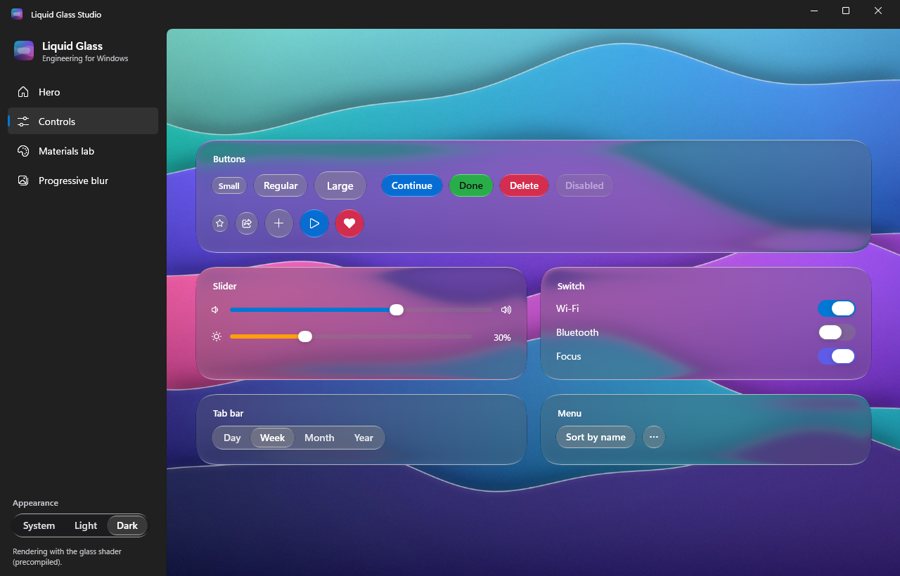

# Liquid Glass for Windows (WPF)

Liquid Glass Engineering for Windows is a WPF library that renders Liquid Glass natively: refraction through a
continuous-corner bevel, the Clear and Regular materials, the rim light, and elastic, illuminated interaction. It
shares one optical model with the SwiftUI and Jetpack Compose ports ([`spec/OPTICS.md`](../spec/OPTICS.md)) and is
verified against the same golden vectors.


- [Install](#install)
- [Quick start](#quick-start)
- [How it works](#how-it-works)
- [Controls](#controls): [GlassScene](#glassscene) · [GlassSurface](#glasssurface) · [GlassButton](#glassbutton) ·
  [GlassToolbar](#glasstoolbar) · [GlassTabBar](#glasstabbar) · [GlassSlider](#glassslider) ·
  [GlassSwitch](#glassswitch) · [GlassMenu](#glassmenu) · [GlassProgressiveBlur](#glassprogressiveblur) ·
  [GlassGeometry](#glassgeometry)
- [Options and theming](#options-and-theming)
- [Accessibility](#accessibility)
- [Performance](#performance)
- [Fallbacks](#fallbacks)
- [Liquid Glass Studio](#liquid-glass-studio)
- [Building from source](#building-from-source)
- [FAQ](#faq)

## Install

| Package | Contents | Targets |
| --- | --- | --- |
| `LiquidGlassEngineering.Wpf` | The WPF controls and the glass shader | `net8.0-windows`, `net10.0-windows` |
| `LiquidGlassEngineering.Core` | The platform-independent optical model (pulled in by the WPF package) | `netstandard2.0` |

```
dotnet add package LiquidGlassEngineering.Wpf
```

or in the project file:

```xml
<PackageReference Include="LiquidGlassEngineering.Wpf" Version="1.0.0" />
```

Requirements: Windows 10 version 1809 or later, or Windows 11; .NET 8 or .NET 10 with WPF (`<UseWPF>true</UseWPF>`).
The shader needs a GPU with pixel shader 3.0, which every DirectX 10-class GPU and the WARP software rasterizer
provide; elsewhere glass draws its [fallback](#fallbacks).

## Quick start

Add the XML namespace and put glass in a `GlassScene`. The scene's `Content` is the backdrop the glass refracts;
everything else goes in the scene's children, laid out like a single-cell `Grid`.

```xml
<Window x:Class="Demo.MainWindow"
        xmlns="http://schemas.microsoft.com/winfx/2006/xaml/presentation"
        xmlns:x="http://schemas.microsoft.com/winfx/2006/xaml"
        xmlns:lg="https://liquid-glass-engineering.vercel.app/wpf"
        Title="Glass" Width="900" Height="600" UseLayoutRounding="True">
  <lg:GlassScene>
    <lg:GlassScene.Content>
      <Image Source="Assets/wallpaper.jpg" Stretch="UniformToFill" />
    </lg:GlassScene.Content>

    <lg:GlassToolbar VerticalAlignment="Top" Margin="0,20,0,0">
      <Button Content="&#xE72B;" FontFamily="Segoe Fluent Icons" AutomationProperties.Name="Back" />
      <Button Content="Library" />
      <lg:GlassToolbarSpacer Sizing="Fixed" />
      <Button Content="&#xE72D;" FontFamily="Segoe Fluent Icons" AutomationProperties.Name="Share" />
    </lg:GlassToolbar>

    <lg:GlassSurface Material="Regular" Radius="28" Width="380" Padding="28"
                     HorizontalAlignment="Center" VerticalAlignment="Center">
      <StackPanel>
        <TextBlock Text="Liquid Glass" FontSize="32" FontWeight="SemiBold" />
        <TextBlock Text="Refraction, frost and light." Opacity="0.75" Margin="0,6,0,18" />
        <lg:GlassButton Content="Get started" Size="Large" Tint="#0A84FF" HorizontalAlignment="Left" />
      </StackPanel>
    </lg:GlassSurface>

    <lg:GlassTabBar VerticalAlignment="Bottom" Margin="0,0,0,24" SelectedIndex="0">
      <lg:GlassTabBarItem Content="Home" />
      <lg:GlassTabBarItem Content="Explore" />
      <lg:GlassTabBarItem Content="Library" />
    </lg:GlassTabBar>
  </lg:GlassScene>
</Window>
```

The same from C#:

```csharp
using LiquidGlass;
using LiquidGlass.Wpf;

var scene = new GlassScene
{
    Content = new Image { Source = new BitmapImage(new Uri("pack://application:,,,/Assets/wallpaper.jpg")), Stretch = Stretch.UniformToFill },
};
scene.Children.Add(new GlassSurface
{
    Material = GlassMaterial.Regular,
    Radius = 28,
    Width = 380,
    Padding = new Thickness(28),
    Content = new TextBlock { Text = "Liquid Glass", FontSize = 32 },
});
Content = scene;
```

Turn on `UseLayoutRounding` on the window so outlines sit on whole device pixels; the rim light is one pixel thin.

## How it works

The scene draws its `Content` once. Every glass surface in the scene, at any depth, holds a live `VisualBrush`
copy of what lies beneath it: the scene's backdrop, any progressive blur, and the glass of the surfaces that enclose
it. The copy is aligned to the surface's exact position (including while it moves, scales under a press or animates)
and extends past it as far as refraction and frost reach. The glass pixel shader (HLSL, pixel shader 3.0, a
line-by-line translation of [`spec/shaders/liquid-glass.glsl`](../spec/shaders/liquid-glass.glsl)) then refracts the
copy through the 20-unit bevel, tones it, adds the rim light and the pointer glow, and WPF composites the result over
the real backdrop. Regular glass reads a copy frosted by WPF's `BlurEffect` (σ 7.33); the shader adds the wide
σ 23 fill blur from that frost on a sparse grid.

The shader ships precompiled by fxc; if the embedded bytecode does not match the embedded HLSL, the library compiles
the HLSL at run time with `D3DCompile` from `d3dcompiler_47.dll`. `GlassDiagnostics.Describe()` reports which path
is in use.

Labels, icons and other children of a surface draw above its glass and are not refracted. Only the scene's `Content`
(and glass and progressive blurs) are refracted; ordinary elements among the scene's children are not.

## Controls

### GlassScene

The region glass may refract. Its attached properties set the defaults that every glass control inside inherits.

```xml
<lg:GlassScene lg:GlassScene.Material="Regular" lg:GlassScene.Appearance="Dark" lg:GlassScene.Motion="Reduced">
  <lg:GlassScene.Content>
    <!-- Anything: an image, a video, a scrolling list. Do not put glass here. -->
  </lg:GlassScene.Content>
  <!-- Glass and other elements -->
</lg:GlassScene>
```

| Member | Type | Default | Description |
| --- | --- | --- | --- |
| `Content` | `UIElement` | null | The backdrop. |
| `Children` | `UIElementCollection` | | Elements over the backdrop (the XAML content property). |
| `Material` (attached, inherited) | `GlassMaterial` | `Clear` | `Clear` or `Regular`. |
| `Appearance` (attached, inherited) | `GlassAppearance` | `Automatic` | `Automatic` follows the Windows app mode. |
| `Motion` (attached, inherited) | `GlassMotion` | `Full` | `Full`, `Reduced`, `None`. Windows' animation setting always applies. |
| `RenderMode` (attached, inherited) | `GlassRenderMode` | `Automatic` | `Automatic`, `Shader`, `Fallback`. |
| `ReduceTransparency` (attached, inherited) | `bool?` | null | Opaque fill instead of glass; null follows Windows. |
| `IncreaseContrast` (attached, inherited) | `bool` | false | 1-unit inner border and the Regular material. |
| `IsDark` (attached, read-only) | `bool` | | Whether a glass control draws dark glass. |
| `ContentForeground` (attached, read-only) | `Brush` | | The default foreground of a glass control. |
| `IsFocusVisible` (attached, read-only) | `bool` | | Keyboard focus arrived from the keyboard. |
| `InvalidateGlass()` | method | | Re-aligns glass after moving it with a render transform animated outside the library. |
| `FindScene(element)` | static | | The scene that contains an element. |

```csharp
GlassScene.SetMaterial(window, GlassMaterial.Regular);
GlassScene.SetAppearance(window, GlassAppearance.Dark);
```

### GlassSurface

A glass container (a `ContentControl`). Its content draws above glass that refracts the scene's backdrop.

```xml
<lg:GlassSurface Material="Regular" Radius="28" Refraction="60" Tint="#330A84FF"
                 IsInteractive="True" IsFluid="True" Padding="20">
  <TextBlock Text="Drag me" />
</lg:GlassSurface>
```

| Property | Type | Default | Description |
| --- | --- | --- | --- |
| `Material`, `Appearance`, `Motion` | | inherited | As on the scene; setting them here applies to the glass inside too. |
| `Radius` | `GlassRadius` | `16` | Units (continuous corner), `capsule` or `circle`. |
| `Refraction` | `double` | `60` | Optical travel at the outline, in units. |
| `Tint` | `Color?` | null | Colors the glass, never the content. The color's alpha is ignored. |
| `IsInteractive` | `bool` | false | Press grow, drag stretch, release overshoot and the pointer glow. |
| `IsFluid` | `bool` | false | The outline springs to its new box when layout changes. |
| `IsFocusRingVisible` | `bool` | false | Draws the focus ring around the outline. |
| `IsPressed` | `bool` (read-only) | | A pointer or key holds the surface down. |
| `RenderedMode` | `GlassLensMode?` | | `Shader`, `Fallback`, `Opaque` or `HighContrast`. |

The surface hit-tests its rounded outline: clicks in the corners outside it pass through.

### GlassButton

A `Button` made of interactive glass. Text buttons are capsules; icon-only buttons are circles. Heights are 24, 32
and 40 units, labels 14 semibold Segoe UI Variable.

```xml
<lg:GlassButton Content="Share" Click="OnShare" />
<lg:GlassButton Content="Continue" Size="Large" Tint="#0A84FF" Command="{Binding Next}" />
<lg:GlassButton IsIconOnly="True" Content="&#xE734;" FontFamily="Segoe Fluent Icons"
                AutomationProperties.Name="Favorite" />
```

```csharp
var share = new GlassButton { Content = "Share", Size = GlassButtonSize.Small };
share.Click += (_, _) => Share();
```

| Property | Default | Description |
| --- | --- | --- |
| `Size` | `Regular` | `Small` (24), `Regular` (32), `Large` (40). |
| `IsIconOnly` | false | Square, circular outline. Give it `AutomationProperties.Name`. |
| `Radius` | `capsule` | `circle` for icon-only buttons. |
| `Tint`, `Refraction`, `IsInteractive`, `Material`, `Appearance` | | As on `GlassSurface`. |

Everything else is `Button`: `Click`, `Command`, `IsDefault`, `IsCancel`, access keys (`_Save`).

### GlassToolbar

A floating toolbar: capsule glass 40 units tall with a 4-unit inset. `GlassToolbarSpacer` splits it into separate
glass clusters; `Sizing="Flexible"` (default) fills the space between them, `Fixed` leaves an 8-unit gap. Plain
`Button`s and `ToggleButton`s inside take the toolbar style; pressing anywhere on a cluster presses its glass, and
clusters spring to their new size when items come and go.

```xml
<lg:GlassToolbar HorizontalAlignment="Stretch" Margin="24,20">
  <Button Content="&#xE72B;" FontFamily="Segoe Fluent Icons" AutomationProperties.Name="Back" />
  <Button Content="Journal" />
  <lg:GlassToolbarSpacer />
  <ToggleButton Content="&#xE734;" FontFamily="Segoe Fluent Icons" AutomationProperties.Name="Favorite" />
  <Button Content="&#xE712;" FontFamily="Segoe Fluent Icons" AutomationProperties.Name="More" />
</lg:GlassToolbar>
```

```csharp
toolbar.Items.Add(new Button { Content = "Edit" });
toolbar.Items.Insert(2, new GlassToolbarSpacer { Sizing = GlassSpacerSizing.Fixed });
```

Properties: `Items`, `Orientation`, `Inset` (4), `Spacing` (4), `Radius` (`capsule`), `Refraction`, `Tint`,
`IsInteractive` (true), `Material`, `Appearance`. UI Automation: `ToolBar`.

### GlassTabBar

A capsule tab bar (a `ListBox`): a Clear glass lens slides between the items on the track spring and stretches with
its speed; it can be dragged across the bar. Arrow keys move the selection. Selected labels are at full opacity, the
others at 0.85.

```xml
<lg:GlassTabBar SelectedIndex="{Binding Section}">
  <lg:GlassTabBarItem Content="Library" />
  <lg:GlassTabBarItem Content="For You" />
  <lg:GlassTabBarItem Content="Search" />
</lg:GlassTabBar>
```

`ItemsSource`, `SelectedItem`, `SelectionChanged` and data templates work as on any `ListBox`. UI Automation: `Tab`
with `TabItem` children and the Selection pattern.

### GlassSlider

A `Slider` with a 6-unit track, an accent fill, and a 20 × 16 white thumb that lifts into Clear glass (refraction 5,
growing 2.5 × 2 per side) while it is dragged; the lifted glass refracts the track. Clicking the track moves the thumb
there. Keyboard steps, ticks, snapping, vertical orientation and the RangeValue automation pattern all come from
`Slider`.

```xml
<lg:GlassSlider Minimum="0" Maximum="100" Value="{Binding Volume}" AutomationProperties.Name="Volume" />
<lg:GlassSlider Orientation="Vertical" Height="180" Tint="#FF9F0A" />
```

`Tint` colors the fill (default: the Windows accent color).

### GlassSwitch

A `ToggleButton` drawn as a 54 × 24 switch. The thumb (32 × 20) moves on the measured switch spring (response
0.47 s, damping 0.7) and lifts into Clear glass while pressed (refraction 7.75, growing 9 × 5.5 per side). Drag the
thumb, click, or press Space. `Content` is the label, drawn before the track.

```xml
<lg:GlassSwitch Content="Wi-Fi" IsChecked="{Binding WifiEnabled}" />
<lg:GlassSwitch Content="Focus" Tint="#5E5CE6" />
```

`Tint` colors the track when on (default: the Windows accent color). UI Automation: the Toggle pattern.

### GlassMenu

A glass button (`Header` is its content) that opens a menu: a Regular glass panel that grows out of the button with
the morph spring and collapses back into it. The menu closes when an item is chosen, on Escape and on a click outside
it; Down or Enter on the button opens it with the first item focused, and arrow keys move between items. The panel
floats in the enclosing scene (it cannot leave the window); outside a scene it opens in a popup with the opaque
material.

```xml
<lg:GlassMenu Header="Sort" Placement="Bottom">
  <lg:GlassMenuItem Header="Name" IsCheckable="True" IsChecked="True" />
  <lg:GlassMenuItem Header="Date modified" IsCheckable="True" />
  <Separator />
  <lg:GlassMenuItem Header="Copy" Icon="&#xE8C8;" InputGestureText="Ctrl+C" Command="ApplicationCommands.Copy" />
</lg:GlassMenu>

<lg:GlassMenu IsIconOnly="True" Header="&#xE712;" FontFamily="Segoe Fluent Icons" AutomationProperties.Name="More">
  <lg:GlassMenuItem Header="Rename" FontFamily="Segoe UI Variable Text" />
</lg:GlassMenu>
```

```csharp
menu.IsOpen = true;            // or menu.Close()
menu.Opened += (_, _) => Log("opened");
```

| Member | Default | Description |
| --- | --- | --- |
| `IsOpen` | false | Two-way bindable. |
| `Placement` | `Bottom` | `Bottom` or `Top`; flips when there is no room. |
| `PanelMaterial` | `Regular` | Material of the panel. |
| `PanelRadius` | 28 | Corner radius of the panel. |
| `Size`, `IsIconOnly`, `Tint` | | Of the trigger button. |
| `Opened`, `Closed` | events | |

`GlassMenuItem` (a `ButtonBase`): `Header`, `Icon`, `InputGestureText`, `IsCheckable`, `IsChecked`,
`StaysOpenOnClick`, `Command`, `Click`. UI Automation: the menu is a Button with ExpandCollapse; items are MenuItems
with Invoke (and Toggle when checkable).

### GlassProgressiveBlur

Progressive edge blur over the scene's backdrop: six blur levels whose strength rises toward `Edge` across a band
`Size` units deep (OPTICS §7). Glass above the band refracts the blurred backdrop. Place it among the scene's
children, stretched over the area whose edge should blur; it takes no input.

```xml
<lg:GlassScene>
  <lg:GlassScene.Content>
    <ScrollViewer><StackPanel x:Name="Articles" /></ScrollViewer>
  </lg:GlassScene.Content>
  <lg:GlassProgressiveBlur Edge="Top" Size="120" Blur="20" />
  <lg:GlassProgressiveBlur Edge="Bottom" Size="100" />
  <lg:GlassToolbar VerticalAlignment="Top" Margin="24,20" />
</lg:GlassScene>
```

`Edge` (`Top`, `Bottom`, `Left`, `Right`), `Size` (80), `Blur` (σ at the edge, 20, at most 33), `Source` (an element to
blur outside a scene; default: the scene's backdrop).

### GlassGeometry

Continuous-corner outlines as frozen WPF geometry, for clips, borders, focus rings and hit shapes that match glass
exactly.

```csharp
var outline = GlassGeometry.Create(new Size(200, 64), GlassRadius.Capsule);
var ring = GlassGeometry.Inflate(new Rect(0, 0, 200, 64), GlassRadius.FromValue(20), 2);
element.Clip = GlassGeometry.Create(new Rect(element.RenderSize), 28);
```

## Options and theming

**Material.** `Clear` shows the refracted backdrop with a light tone curve and veil; `Regular` frosts it first.
Menus default to Regular; everything else to Clear. Material is inherited, so setting it on a container applies to
the glass inside; reset it for nested controls with `lg:GlassScene.Material="Clear"`.

**Appearance.** `Automatic` follows Settings › Personalization › Colors › *Choose your app mode* and updates live.
Foreground defaults to `#111113` on light glass and white on dark or strongly tinted glass; set `Foreground` to
override it.

**Radius.** `GlassRadius` parses `16`, `capsule` and `circle`. Fixed radii are superellipse corners with continuous
curvature; large radii blend into a capsule, so animating the radius never jumps.

**Tint.** Colors the glass (never the content) by transmitting the backdrop's luminance through the pigment. On
`GlassSlider` and `GlassSwitch` it colors the fill and track instead (default: the Windows accent).

**Motion.** Springs follow OPTICS §6 (press 0.24/0.20, release 0.50/0.42, glow 0.42/0, morph 0.42/0.18, layout
0.40/0.16, track 0.18/0). `Reduced` removes grow, stretch and overshoot; `None` removes transitions. When Windows'
*Animation effects* are off, `Full` behaves as `Reduced`.

**Styling.** All controls have default styles in `Themes/Generic.xaml` and can be restyled or retemplated. Templates
keep a `GlassLens` (the glass) beneath their content; see the default templates for the named parts.

## Accessibility

- **UI Automation.** Buttons, switches (Toggle), sliders (RangeValue), tab bars (Tab/TabItem, Selection), toolbars
  (ToolBar), menus (ExpandCollapse) and menu items (MenuItem, Invoke, Toggle) expose the expected roles and
  patterns. Give icon-only controls an `AutomationProperties.Name`.
- **Keyboard.** Tab moves between controls; Space and Enter press buttons and the press glass responds; arrows move
  tab selection, slider values and menu focus; Escape closes menus. A 2-unit focus ring follows each control's
  outline and appears only for keyboard focus.
- **Contrast themes.** With a Windows contrast theme active, glass draws with system colors (`ControlBrush` fill,
  `ControlTextBrush` border and text, `Highlight` for selection) and no transparency.
- **Transparency effects.** When Windows' *Transparency effects* are off, glass is replaced by an opaque fill
  (`#F2F2F7` at 0.94 light, `#1C1C1E` at 0.94 dark) that keeps the rim light. Override with
  `GlassScene.ReduceTransparency`.
- **Increase contrast.** `lg:GlassScene.IncreaseContrast="True"` adds a 1-unit inner border and uses Regular glass.
- **Animation effects.** Off means reduced motion everywhere.

## Performance

- Glass costs a texture copy and one shader pass over each surface's area (plus its refraction margin), and only when
  something beneath or on it changes. Idle windows render nothing: the animation loop runs only while a spring moves.
- Regular glass also blurs its copy (WPF's `BlurEffect`) and samples a 9 × 9 grid for the fill; prefer Clear for
  large surfaces that animate continuously.
- The backdrop is drawn once for the screen and once per surface copy. For a costly backdrop (many elements or text),
  set `CacheMode="BitmapCache"` on the scene's `Content` so copies reuse a cached bitmap.
- Keep `UseLayoutRounding="True"`; surfaces on fractional pixels resample the copy and soften the rim.
- Very large surfaces work but cost proportionally; the copy is limited to the GPU's maximum texture size (16384 on
  current hardware) and WPF scales it down beyond that.

## Fallbacks

Glass never draws nothing and never crashes.

| Situation | What glass draws |
| --- | --- |
| Pixel shader 3.0 in hardware (normal) | The glass shader. |
| No pixel shader 3.0, software rendering (`RenderOptions.ProcessRenderMode = SoftwareOnly`), a window in software mode, Remote Desktop without GPU acceleration, fewer than 1024 shader instruction slots | The fallback material: the frosted copy for Regular, a veil fitted to the material's tone curve, the rim light rasterized from the same model as the shader, the pointer glow and focus ring. |
| `RenderMode="Fallback"` | The fallback material, always. Use it for `RenderTargetBitmap` snapshots, which WPF renders in software. |
| Transparency effects off, `ReduceTransparency`, glass outside a `GlassScene`, glass inside the scene's `Content` | The opaque material with the rim light. |
| Contrast theme | System colors. |
| d3dcompiler_47.dll missing and bytecode stale | The fallback material. |

`GlassDiagnostics.Describe()` returns the render tier, pixel shader support and shader status, for logs and about
boxes.


## Liquid Glass Studio

The Windows demo shows every control on the shared wallpapers, in light and dark, with Mica window chrome on
Windows 11:

1. **Hero:** a draggable Regular card, a floating toolbar and a tab bar.
2. **Controls:** buttons of every size and tint, icon buttons, sliders, switches, a tab bar and menus.
3. **Materials lab:** live controls for material, appearance, refraction, radius, tint, wallpaper, fallback and
   increased contrast, with a draggable lens.
4. **Progressive blur:** a scrolling journal under blurred edges, a toolbar and a tab bar.

Download `LiquidGlassStudio-win-x64.zip` (needs the [.NET 10 Desktop Runtime](https://dotnet.microsoft.com/download/dotnet/10.0)),
`LiquidGlassStudio-win-arm64.zip`, or the self-contained `LiquidGlassStudio-win-x64-self-contained.zip`, unzip and run
`LiquidGlassStudio.exe`. Command-line options open a page directly:
`--page hero|controls|materials|blur --appearance system|light|dark --render-mode automatic|fallback`.



## Building from source

The solution is `platforms/windows/LiquidGlass.sln`: `LiquidGlass.Core`, `LiquidGlass.Wpf`, `LiquidGlass.Studio`,
`LiquidGlass.Core.Tests`, `LiquidGlass.Wpf.Tests` and `tools/LiquidGlass.CiTools`.

```
cd platforms/windows
scripts/dotnet.sh build LiquidGlass.sln -c Release      # also on macOS and Linux (EnableWindowsTargeting)
scripts/dotnet.sh test tests/LiquidGlass.Core.Tests      # anywhere
scripts/package.sh                                       # NuGet packages and Studio zips into artifacts/windows
```

`LiquidGlass.Wpf.Tests` needs Windows (WPF, Direct3D 11): it checks the embedded shader bytecode, compiles the shader
with D3DCompile, evaluates the HLSL library against the golden vectors on WARP within the GPU tolerance, and exercises
the controls. The [Windows workflow](../.github/workflows/windows.yml) builds, tests, compiles the shader with fxc,
captures Studio and smoke-tests published builds on every change.

After editing `Shaders/*.fx` or `LiquidGlass.hlsli`, refresh `Shaders/Compiled/GlassSurface.ps` and `.sha256` from the
workflow's fxc output; until then the library compiles the shader at run time.

## FAQ

**Why does my glass look like plain translucency?** Check `RenderedMode` on a surface, or `GlassDiagnostics.Describe()`.
Remote Desktop, virtual machines without GPU acceleration and `RenderTargetBitmap` draw the fallback material.

**Can glass refract other controls?** Glass refracts the scene's `Content`, progressive blurs and the glass that
encloses it. Put what should be refracted into `Content`.

**Can glass go inside `GlassScene.Content`?** No: it would refract itself. It draws the opaque material there.

**Can I use it with WinUI or MAUI?** This package is WPF. The optical model in `LiquidGlassEngineering.Core` is
platform-independent.

**Does a menu extend outside the window?** No, menus float within their scene so they can refract its backdrop. Outside
a scene a menu opens in a popup with the opaque material.

**How do I move glass with my own animation?** Layout-driven movement (margins, `Canvas.Left`) re-aligns automatically.
After animating a `RenderTransform` yourself, call `GlassScene.InvalidateGlass()` each frame, or animate layout
properties instead.

**Is it an Apple product?** No. Liquid Glass Engineering is an independent native port of the MIT-licensed Glass HQ
liquid-glass web library; see [NOTICE.md](../NOTICE.md).
