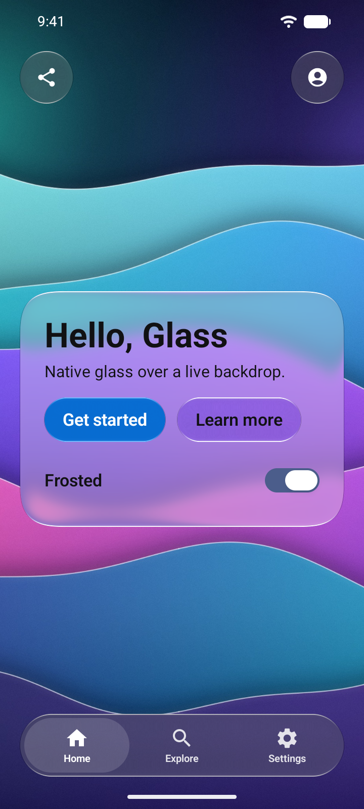
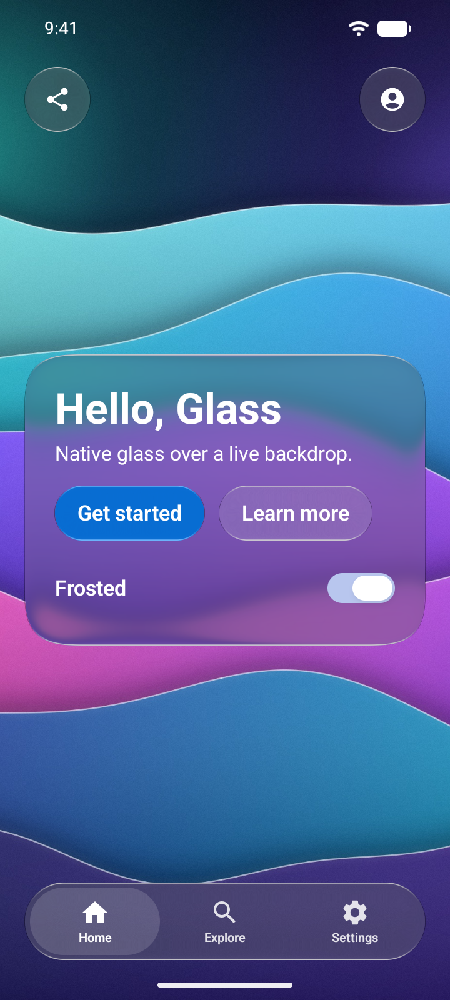

# Hello Glass for Jetpack Compose

The smallest complete Liquid Glass app for Android: one screen, one Kotlin file ([`MainActivity.kt`](app/src/main/kotlin/io/github/rookasrudzianskas/liquidglass/hello/MainActivity.kt)). Every native platform builds this same screen in [`examples/`](..), so their screenshots line up side by side.

<p align="center">
  
  
</p>

## What it shows

- **`GlassScene` and `GlassContent`**: the Aurora wallpaper (`res/drawable-nodpi/aurora.jpg`) is the content every glass surface refracts. It runs edge to edge, under the status and navigation bars.
- **A Regular glass card** (`GlassSurface`, continuous 32 dp corners) with the title "Hello, Glass", a one-line subtitle, a prominent tinted button "Get started" and a plain glass button "Learn more".
- **A "Frosted" switch** (`GlassSwitch`) that turns the card from Regular (frosted) to Clear glass and back.
- **A toolbar** (`GlassToolbar`) with two icon buttons, Share and Profile, and **a floating tab bar** (`GlassTabBar`) with Home, Explore and Settings. "Get started" selects Explore and Profile selects Settings.
- **A layout that fits.** The toolbar, the card and the tab bar stack inside the safe area (status and navigation bars, display cutout). The card is centered in the space between the bars, and when that space is too short for it (a phone in landscape, a large font size) it scrolls instead of running under the tab bar.
- **Light and dark.** The card follows the system theme. The bars sit over the wallpaper's dark top and bottom, so they are dark glass in both themes and the status bar icons stay light.
- **Accessibility.** The title is a heading, the icon buttons have content descriptions and the switch carries its own label ("Frosted"), so TalkBack reads each control once. Glass refraction never touches the text: labels draw above the glass.
- **Default refraction.** Nothing sets `refraction`, so every surface follows its own size, `min(60 dp, 0.75 × the shorter side)`: the card gets the full 60 dp, the 44 dp buttons 33 dp, the 52 dp toolbar clusters 39 dp and the 62 dp tab bar 46.5 dp.

## Run it

Needs JDK 17 and the Android SDK. Set `ANDROID_HOME`, which covers both builds: inside this repository the example includes the library's own Gradle build from [`platforms/android`](../../../platforms/android), and that build looks for the SDK on its own. With `sdk.dir` instead, put it in both `examples/compose/HelloGlass/local.properties` and `platforms/android/local.properties`. The glass itself needs Android 13 (API 33) or newer; Android 7 to 12 draw the library's fallback material.

```sh
cd examples/compose/HelloGlass
./gradlew :app:assembleDebug
adb install app/build/outputs/apk/debug/app-debug.apk
```

Or open this folder in Android Studio and run the `app` configuration. On an emulator, use an API 33+ image with GPU emulation (`-gpu host` or `swiftshader_indirect`).

## Depend on the published package

The app depends on the library by its published coordinates, through the version catalog:

```toml
# gradle/libs.versions.toml
[versions]
liquidGlass = "1.0.1"

[libraries]
liquid-glass-compose = { module = "io.github.rookasrudzianskas:liquid-glass-compose", version.ref = "liquidGlass" }
```

```kotlin
// app/build.gradle.kts
dependencies {
    implementation(libs.liquid.glass.compose) // or implementation("io.github.rookasrudzianskas:liquid-glass-compose:1.0.1")
}
```

Inside this repository, [`settings.gradle.kts`](settings.gradle.kts) resolves that coordinate from the library's source next to it, so the example builds offline and in CI against the current code:

```kotlin
includeBuild("../../../platforms/android") {
    dependencySubstitution {
        substitute(module("io.github.rookasrudzianskas:liquid-glass-compose")).using(project(":liquidglass"))
    }
}
```

To build it anywhere else (or to start your own app from it), delete that `includeBuild` block and add the project's Maven repository instead:

```kotlin
// settings.gradle.kts
dependencyResolutionManagement {
    repositories {
        google()
        mavenCentral()
        maven("https://liquid-glass-engineering.vercel.app/maven")
    }
}
```

The repository serves the build of the `1.0.1` release.

JitPack works too, as a secondary route: add `maven("https://jitpack.io")` and depend on `com.github.rookasrudzianskas:liquid-glass-mac-windows-ios-android:1.0.1` (JitPack builds a version the first time it is requested, which can take a few minutes). The [Android guide](../../../docs/android.md#install) has every install route, including the plain AAR.
