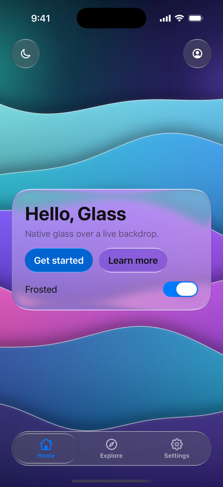
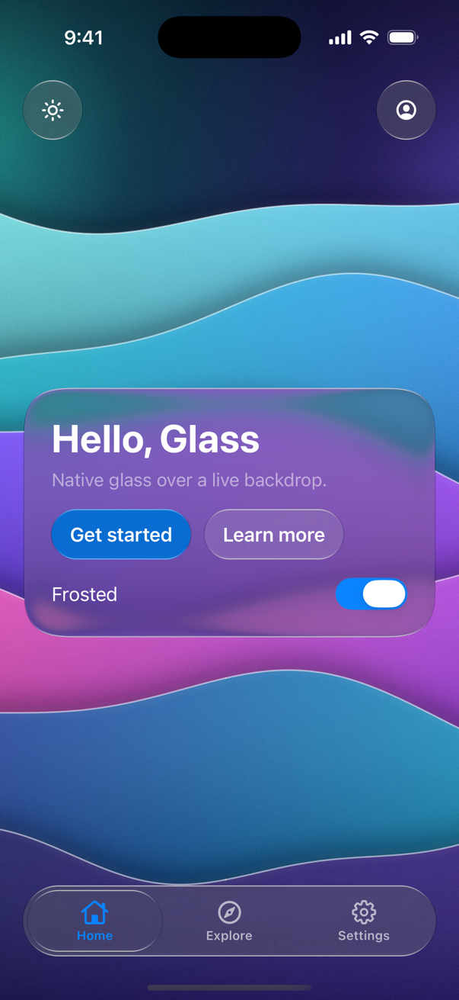

# Hello, Glass (SwiftUI)

The smallest complete Liquid Glass app for iOS 17+ and macOS 14+: one screen over the aurora wallpaper with

- a centered Regular glass card (continuous corners, radius 32) titled "Hello, Glass", a one-line subtitle, a
  prominent tinted **Get started** button and a plain glass **Learn more** button,
- a **Frosted** switch that turns the card from Regular into Clear glass and back,
- a top `GlassToolbar` with two icon buttons (switch between light and dark, profile),
- a floating `GlassTabBar` with Home, Explore and Settings. Get started selects Explore, and Profile selects Settings.

The card follows the system appearance until you pick one in the toolbar. The bars sit over the wallpaper's dark top
and bottom, so they are dark glass in both appearances and their labels stay white.

The wallpaper is the `GlassContent`, so every piece of glass refracts it live. All glass leaves `refraction` unset, so
each piece travels by its own size on iOS: 60 for the card, 39 for the 52 pt toolbar clusters, 46.5 for the 62 pt
tab bar. Every control has an accessibility label, and the title and subtitle read as one element.

The same screen exists for [Jetpack Compose](../../compose/HelloGlass) and [WPF](../../wpf/HelloGlass), so the screenshots line up.

<p align="center">
  
  
</p>

## Run it

Open `HelloGlass.xcodeproj` in Xcode 16 or later, pick the **HelloGlass** scheme and an iPhone simulator or **My
Mac**, and press Run. The app is one multiplatform target; the code is
[`HelloGlass/ContentView.swift`](HelloGlass/ContentView.swift).

From the command line (from this folder):

```sh
xcodebuild build -project HelloGlass.xcodeproj -scheme HelloGlass -destination "generic/platform=iOS Simulator"
xcodebuild build -project HelloGlass.xcodeproj -scheme HelloGlass -destination "platform=macOS"
```

The project signs to run locally, which covers the simulator and the Mac. To run on an iPhone, turn on
**Automatically manage signing** under **Signing & Capabilities** and choose your team.

## Depend on the published package

The project uses the library from this repository through a local package reference to the repository root
(`../../..`), so it always builds against the source next to it. In your own app, depend on the published package
instead:

1. In Xcode, select the project, open **Package Dependencies**, and remove the local `LiquidGlass` package.
2. Choose **+** (or **File › Add Package Dependencies…**), enter
   `https://github.com/rookasrudzianskas/liquid-glass-mac-windows-ios-android`, set **Up to Next Major Version** from
   `1.0.2`, and add the **LiquidGlass** library to the HelloGlass target.

With a `Package.swift`, the same dependency is

```swift
dependencies: [
    .package(url: "https://github.com/rookasrudzianskas/liquid-glass-mac-windows-ios-android", from: "1.0.2"),
],
targets: [
    .target(name: "MyApp", dependencies: [
        .product(name: "LiquidGlass", package: "liquid-glass-mac-windows-ios-android"),
    ]),
]
```

The code doesn't change: it imports `LiquidGlass` either way. The full guide is [`docs/apple.md`](../../../docs/apple.md).
