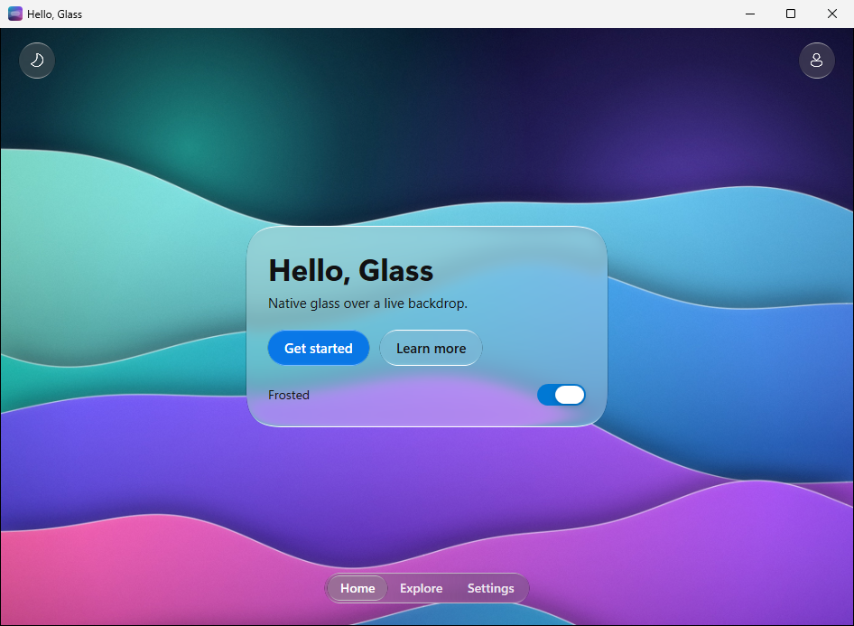
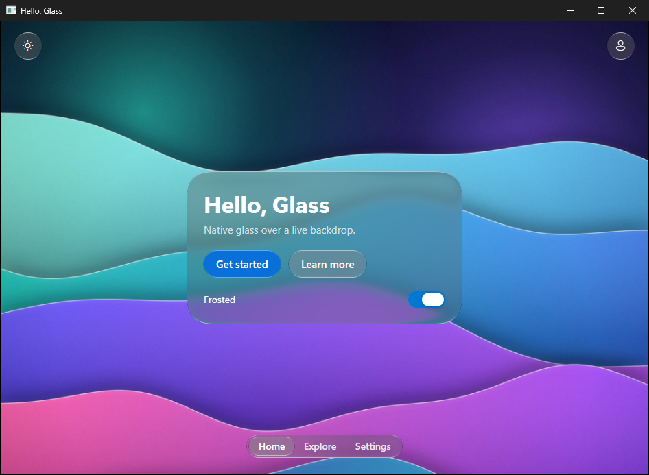

# Hello Glass for WPF

One window of Liquid Glass over the aurora wallpaper: the same screen as the [SwiftUI](../../swiftui/HelloGlass) and
[Jetpack Compose](../../compose/HelloGlass) Hello Glass examples, written in XAML with
[Liquid Glass Engineering for Windows](../../../docs/windows.md).

<p align="center">
  
  
</p>

*Captured on a GitHub Actions Windows runner by the [Windows workflow](../../../.github/workflows/windows.yml), which
builds and launches this example on every change to it.*

What it shows:

- A `GlassScene` whose `Content` is the wallpaper (`Assets/aurora.jpg`, embedded as a WPF resource): what the glass
  refracts. It is drawn with an `ImageBrush`, so screen readers skip the decorative picture.
- A centered Regular `GlassSurface` card with continuous corners: the title "Hello, Glass", a one-line subtitle, a
  tinted **Get started** `GlassButton` that selects the Explore tab and a plain glass **Learn more** that opens the
  [Windows guide](../../../docs/windows.md).
- A `GlassSwitch` labelled **Frosted** that turns the card between Regular (frosted) and Clear glass, with a style
  trigger in XAML. The controls on the card stay Clear glass either way.
- A `GlassToolbar` with two icon buttons: **Switch appearance** (a moon in light appearance, a sun in dark) turns the
  card between light and dark glass, and **Profile** selects the Settings tab.
- A floating `GlassTabBar` with three tabs: Home, Explore and Settings.
- Light and dark: the card and the window's title bar (Windows 10 version 2004 and later) follow the Windows app mode
  (Settings > Personalization > Colors) until the toolbar switches them; the bars stay dark glass, so their white
  labels read over the wallpaper's deep colors.
- Refraction by size: nothing sets `Refraction`, so every surface follows its own resting size,
  `min(60, 0.75 × the shorter side)`: 60 for the card, 30 for the 40-unit buttons and toolbar clusters, 25.5 for the
  34-unit tab bar.
- Accessibility: the icon buttons, the card and the tab bar have automation names, the title is a heading, and
  everything works from the keyboard (Tab, Space, the arrow keys in the tab bar).

| File | What it holds |
| --- | --- |
| `MainWindow.xaml` | The screen. |
| `MainWindow.xaml.cs` | The handlers of the four buttons, and the title bar and appearance glyph that follow the card's appearance. |
| `App.xaml` | Starts `MainWindow`. |
| `HelloGlass.csproj` | `net8.0-windows` with WPF and nullable reference types; the library reference, the wallpaper and the icon. |
| `app.manifest` | Per-monitor DPI awareness, so the one-pixel rim light stays sharp on every display scale. |
| `Assets/aurora.jpg` | The wallpaper, a copy of `assets/wallpapers/aurora-2048.jpg`. |
| `Assets/HelloGlass.ico` | The application icon (title bar and taskbar), a copy of `platforms/windows/packaging/LiquidGlass.ico`. |

## Run it

On Windows 10 (version 1809 or later) or Windows 11 with the [.NET 10 SDK](https://dotnet.microsoft.com/download), from
the repository root:

```powershell
dotnet run --project examples/wpf/HelloGlass
```

or open `HelloGlass.csproj` in Visual Studio 2026 and press F5. The app targets .NET 8, but building it from this
repository builds the library too, and the library also targets .NET 10, so it needs the .NET 10 SDK. Once the
project uses the published package (below), the .NET 8 SDK or Visual Studio 2022 is enough.

On macOS and Linux the example builds (running it needs Windows):

```sh
dotnet build examples/wpf/HelloGlass -p:EnableWindowsTargeting=true
```

## Use the published package

The project builds against the library's source in this repository
(`platforms/windows/src/LiquidGlass.Wpf`). To use the published package instead, for example in a copy of this folder
outside the repository, open `HelloGlass.csproj`, delete the `ItemGroup` with the `ProjectReference`, and uncomment
the block below it:

```xml
<PropertyGroup>
  <RestoreAdditionalProjectSources>https://liquid-glass-engineering.vercel.app/nuget/index.json</RestoreAdditionalProjectSources>
</PropertyGroup>
<ItemGroup>
  <PackageReference Include="LiquidGlassEngineering.Wpf" Version="1.0.0" />
</ItemGroup>
```

The packages are on the project's own NuGet feed, not on nuget.org; `RestoreAdditionalProjectSources` adds the feed
for this project only, and `LiquidGlassEngineering.Core` comes with the package. To add the feed for every project
instead, as the [install instructions](../../../docs/windows.md#install) do, delete the `ProjectReference` and run:

```powershell
dotnet nuget add source https://liquid-glass-engineering.vercel.app/nuget/index.json -n liquid-glass
dotnet add package LiquidGlassEngineering.Wpf --version 1.0.0
```

The guide also shows a `nuget.config` that keeps the feed with your solution. The XAML namespace
(`https://liquid-glass-engineering.vercel.app/wpf`) and the code are the same with either reference.
